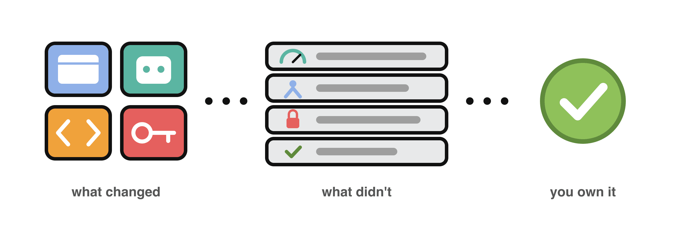

> TL;DR; In 2026 models moved into the browser, agents moved into our editors and terminals, and identity became the guardrail for software acting on people's behalf. The fundamentals didn't move at all: performance, accessibility, security, review and accountability are still on us. 🎉

_This post closes my series "AI on the web in 2026". It's an opinion piece, and every link below goes to a post in the series with the official sources._

### Why a retrospective?

When I started this series with [a map of what actually shipped](/posts/ai-on-the-web-in-2026-a-gde-map-of-what-shipped/), I made one rule: if I couldn't point to an official source, it wasn't on the map. Twenty posts later, I want to step back and answer the question I get after every talk: _"So, what actually changed for us?"_

My honest answer has two halves. A lot changed in **where** AI runs and **who** writes the code. Almost nothing changed in **what makes a web app good**.

### What changed

#### 1. AI moved into the browser

At the start of the year, "AI feature" mostly meant "API call to a cloud model". Now Chrome ships task APIs like the Summarizer, Translator and Language Detector, and the Prompt API reached the web on desktop with structured output. The cloud didn't disappear. It became the fallback, with SDKs that prefer the on-device model and switch to a cloud one when the device can't.

That changes the cost model and the privacy story of a feature. It also changes the code: availability checks, model downloads and fallbacks are now part of the happy path.

#### 2. Agents moved into our tools

Google Antigravity went from a public preview at the end of 2025 to a full platform with a desktop app, a CLI and an SDK, and Gemini CLI users were asked to move to the Antigravity CLI. Chrome DevTools MCP gave agents a real browser to measure what they built.

The biggest shift for me wasn't speed. It was that an agent can now **show its work**: a plan, a screenshot, a trace. That makes review possible at a new scale, if we actually do it.

#### 3. Frameworks started teaching agents

Angular published `llms.txt` files, an MCP server in the CLI and best-practice rules, and its modern defaults (signals, zoneless, standalone) turned out to be easier for agents to get right. Angular even added experimental WebMCP support. **A framework's conventions are now part of its AI story.**

#### 4. Identity became the guardrail

This is the area I care about most as an Identity GDE. Passkeys, FedCM, the Digital Credentials API, OAuth delegation, A2A, AP2 and WebMCP all answer the same question from different angles: _when software acts for a person, who is acting, and what are they allowed to do?_

### What didn't change

Here is the part I want you to take back to your team.

#### Performance is still a feature

A streaming answer that blocks the main thread is still a slow page. Agents can measure Core Web Vitals now, which is great, but someone has to care about the numbers and set the budget.

#### Accessibility is still not optional

A skeleton loader without the right ARIA attributes is still noise for a screen reader. A chat UI that doesn't announce new content is still broken. Generated code does not get a pass.

#### Security still lives on the server

Every AI-assisted form still validates on the server. Every tool exposed to an agent still goes through the same authorization as a button. Prompt injection is just one more reason to keep it that way.

#### Review and accountability are still human

I said this in my talk recap, [Frontend in the AI Era](/posts/frontend-in-the-ai-era-scaling-apps-from-prompt-to-prod/), and a year of using these tools only made me more sure about it.

> AI generates ideas, but you are responsible for the final quality. That sentence didn't need an update in 2026 ❤️

### The whole series, in one place

If you missed any post, here is the full list with one line each:

1. [AI on the web in 2026 — a GDE's map of what actually shipped](/posts/ai-on-the-web-in-2026-a-gde-map-of-what-shipped/): the map of the year and the guide to the series.
2. [Built-in AI in Chrome — Summarizer, Translator and Language Detector in production](/posts/built-in-ai-in-chrome-summarizer-translator-language-detector-in-production/): shipping Chrome's task APIs with feature detection and fallbacks.
3. [Structured output from the Chrome Prompt API with JSON Schema](/posts/structured-output-from-the-chrome-prompt-api-with-json-schema/): typed, parseable JSON from Gemini Nano.
4. [Hybrid inference with Firebase AI Logic](/posts/hybrid-inference-with-firebase-ai-logic-on-device-first-cloud-fallback/): on-device first, cloud fallback, one API.
5. [Streaming Gemini responses into Angular signals](/posts/streaming-gemini-responses-into-angular-signals/): chunk-by-chunk UI, zoneless, with cancellation.
6. [Angular CLI MCP server and llms.txt](/posts/angular-cli-mcp-server-and-llms-txt-teaching-agents-modern-angular/): teaching agents modern Angular.
7. [Zoneless, signals and conventions](/posts/zoneless-signals-and-conventions-making-an-angular-repo-agent-ready/): making an Angular repo agent-ready.
8. [Signal Forms and Gemini](/posts/signal-forms-and-gemini-ai-assisted-form-filling-that-still-validates/): AI-assisted form filling that still validates.
9. [Google Antigravity first impressions](/posts/google-antigravity-first-impressions-agents-artifacts-browser-checks/): agents, Artifacts and browser checks.
10. [From plan to verified UI](/posts/from-plan-to-verified-ui-an-angular-feature-built-in-antigravity/): an Angular feature built in Antigravity, end to end.
11. [Gemini CLI for web projects](/posts/gemini-cli-for-web-projects-gemini-md-custom-commands-and-extensions/): `GEMINI.md`, custom commands, extensions and the move to Antigravity CLI.
12. [Chrome DevTools MCP](/posts/chrome-devtools-mcp-letting-agents-measure-your-core-web-vitals/): letting agents measure your Core Web Vitals.
13. [Feature flagging Gemini features with ngx-feature-toggle](/posts/feature-flagging-gemini-features-in-angular-with-ngx-feature-toggle/): gradual rollouts and a kill switch for AI features.
14. [Skeleton loaders for LLM latency](/posts/skeleton-loaders-for-llm-latency-ngx-skeleton-loader-for-streaming-uis/): `ngx-skeleton-loader` for streaming UIs.
15. [Passkeys in the agent era](/posts/passkeys-in-the-agent-era-why-phishing-resistant-sign-in-matters-more/): why phishing-resistant sign-in matters more.
16. [FedCM and Sign in with Google](/posts/fedcm-and-sign-in-with-google-identity-without-third-party-cookies/): identity without third-party cookies.
17. [Digital Credentials API](/posts/digital-credentials-api-proving-facts-without-oversharing/): proving facts without oversharing.
18. [Agents acting for users](/posts/agents-acting-for-users-delegation-oauth-scopes-a2a-and-ap2/): delegation, OAuth scopes, A2A and AP2.
19. [WebMCP](/posts/webmcp-exposing-your-web-app-tools-to-browser-agents/): exposing your web app tools to browser agents.

### What I'd do in 2027

Three things, with reasons:

- **Read the status label first.** Stable, origin trial, preview, behind a flag. Half of this year's confusion came from ignoring it, and some APIs in this series changed shape within months.
- **Make your repo the guardrail, not your tool.** Conventions, lint and tests travel across every agent and every IDE. Tool-specific settings don't.
- **Design for delegation now.** Scoped tokens, a "connected agents" page and step-up approvals are shipping technology today. You'll need them before your users ask.

I'd love to hear your retrospective too. What changed in your team this year, and what stayed exactly the same?

### That’s all for now

Thank you for following this series from the first post to the last. Stay tuned because this is not the end, it's just the beginning.

I hope you enjoyed this reading as much as I enjoyed writing it. Thank you so much for reading until the end and see you soon!

🚀🚀🚀🚀🚀🚀

### Cya 👋
