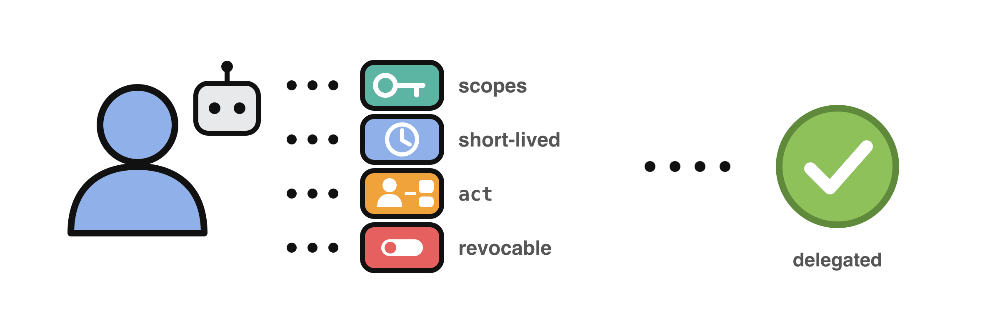

> TL;DR; An agent should never hold your user's password or a forever token. Give it narrow OAuth scopes, short-lived tokens that say _who_ is acting _for whom_ (token exchange), a human approval for anything risky, and a kill switch. A2A and AP2 build on the same idea. 🎉

_This post is part of my series "AI on the web in 2026". It's an opinion piece, based on the OAuth RFCs, the A2A specification and the AP2 documentation linked at the end._

### Why I care about this

During 2026 I've spent a lot of time talking about guardrails for coding agents ([my talk recap is here](/posts/frontend-in-the-ai-era-scaling-apps-from-prompt-to-prod/)). The same question keeps coming back from the product side: _"Our users want an agent to do this for them. How do we let it in?"_

The worst answer is also the easiest one: give the agent the user's session, or worse, their password. It works on the first demo. Then you can't tell what the user did from what the agent did, can't limit what the agent touches, and can't revoke it without logging the user out of everything.

**Delegation is not impersonation.** That's the whole post in one line. Let's unpack it.

### What does "acting for a user" actually need?

I keep coming back to four properties. If one is missing, I wouldn't ship it.

#### 1. Scoped

The agent gets only the permissions for the task. OAuth 2.0 scopes have done this for years: `calendar.read` is not `calendar.write`. When scopes are too coarse, OAuth 2.0 Rich Authorization Requests (RFC 9396) let you describe fine-grained permissions as structured `authorization_details`, such as "pay up to this amount to this merchant".

#### 2. Short-lived and bound

Access tokens should expire quickly. Sender-constrained tokens with DPoP (RFC 9449) make a leaked token much less useful, because the caller has to prove it holds a private key. The OAuth 2.0 Security Best Current Practice (RFC 9700) is the checklist I point teams to.

#### 3. Attributable

Every call should say _who_ is acting _for whom_. This is the part most teams skip, and it's the part that matters most for agents.

#### 4. Revocable

The user needs a single place to see "this agent can do X" and turn it off, without changing their password. Token revocation (RFC 7009) is the protocol piece. The settings page is your job.

### Token exchange: the "on behalf of" primitive

OAuth 2.0 Token Exchange (RFC 8693) is the spec I wish more web developers knew about. Your backend trades the user's token, plus a token that identifies the agent, for a new, narrower token meant for one downstream service:

```http
POST /token HTTP/1.1
Host: auth.example.com
Content-Type: application/x-www-form-urlencoded

grant_type=urn:ietf:params:oauth:grant-type:token-exchange
&subject_token=<user access token>
&subject_token_type=urn:ietf:params:oauth:token-type:access_token
&actor_token=<agent credential>
&actor_token_type=urn:ietf:params:oauth:token-type:jwt
&audience=https://orders.example.com
&scope=orders.read
```

As you can see, the user is the `subject` and the agent is the `actor`. When the issued token is a JWT, RFC 8693 defines the `act` claim to carry that actor, so the orders service (and your audit log) can see both identities instead of just "the user did it".

```json
{
  "sub": "user-123",
  "aud": "https://orders.example.com",
  "scope": "orders.read",
  "act": { "sub": "agent:shopping-assistant" }
}
```

That one claim changes how you debug incidents and explain to a user what happened on their account.

> If your logs can't tell the user apart from the agent, you don't have delegation. You have a shared password with extra steps 🔐

### Human in the loop, for real

Scopes limit _what_ an agent can do. They don't decide _when_ a human should look. For high-risk steps (paying, deleting, sharing data, changing security settings), I ask for a fresh, explicit approval from the user at that moment.

For out-of-band approvals, OpenID Connect CIBA (Client-Initiated Backchannel Authentication) lets a client start a request that the user approves on their own device, without a browser redirect. In the browser, a [passkey](/posts/passkeys-in-the-agent-era-why-phishing-resistant-sign-in-matters-more/) prompt for step-up is a strong signal that a human is present. An agent can't produce it.

Keep in mind that "the user typed yes in a chat" is not the same thing. The approval should happen in UI that your app or the browser controls, not inside a conversation the agent can influence.

### Agent to agent: A2A

Once agents start calling _other_ agents, you need a shared language. That's A2A (Agent2Agent). Google donated it to the Linux Foundation in June 2025, it reached a stable v1.0 specification in 2026, and in August 2026 it moved under the Agentic AI Foundation, which is hosted by the Linux Foundation.

What I like about A2A's security model is that it doesn't reinvent identity:

- Production traffic must use HTTPS.
- Identity lives at the HTTP layer, not in the message payload. Credentials go in standard headers like `Authorization: Bearer <token>`.
- An agent advertises its authentication requirements in its Agent Card, aligned with OpenAPI security definitions such as OAuth 2.0 and OpenID Connect.
- The docs recommend that specific OAuth scopes grant access to specific skills, with least privilege.

A2A gives agents a way to talk. OAuth still decides what they're allowed to say.

### Agents and money: AP2

Payments are where delegation gets serious. AP2 (Agent Payments Protocol) was announced by Google in September 2025 as an extension for A2A and MCP. The original announcement described an **Intent Mandate** (the user's signed rules: price limits, timing, conditions) and a **Cart Mandate** (the user's signed approval of the exact items and price).

The current documentation (v0.2) models the same idea as **Checkout** and **Payment Mandates**, each in two stages:

- **Open**: the user's constraints before the cart is final, such as a budget or allowed merchants. This is what lets an agent act when the user isn't present.
- **Closed**: authorization bound to one specific checkout or amount.

In April 2026, Google donated AP2 to the FIDO Alliance, where standardization continues. One detail I loved: AP2's authorization framework recommends the [Digital Credentials API](/posts/digital-credentials-api-proving-facts-without-oversharing/), where available, for the user to approve a mandate. Identity and payments are converging on the same primitives.

It's still early (v0.2), so I would prototype with it, not bet a checkout on it yet.

### What web developers can build today

You don't have to wait for every agent protocol to settle. This list is all shipping technology:

- **A real "connected agents" page**: which agent, which scopes, granted when, last used, and a revoke button.
- **Separate scopes for read and write**, and a separate one for anything that moves money or data out.
- **Token exchange in your backend** for any agent-initiated call, with the `act` claim logged.
- **Short-lived, sender-constrained tokens** for agent clients (DPoP).
- **Step-up approval** with passkeys for consequential actions, in UI you control.
- **Agent-friendly front ends** that still enforce the rules: [WebMCP tools](/posts/webmcp-exposing-your-web-app-tools-to-browser-agents/) marked as consequential, and forms that [still validate on the server](/posts/signal-forms-and-gemini-ai-assisted-form-filling-that-still-validates/).

None of this is AI-specific. That's exactly why I trust it.

### References

- [RFC 8693 — OAuth 2.0 Token Exchange](https://datatracker.ietf.org/doc/html/rfc8693)
- [RFC 9700 — Best Current Practice for OAuth 2.0 Security](https://datatracker.ietf.org/doc/html/rfc9700)
- [RFC 9396 — OAuth 2.0 Rich Authorization Requests](https://datatracker.ietf.org/doc/html/rfc9396)
- [RFC 9449 — OAuth 2.0 Demonstrating Proof of Possession (DPoP)](https://datatracker.ietf.org/doc/html/rfc9449)
- [RFC 7009 — OAuth 2.0 Token Revocation](https://datatracker.ietf.org/doc/html/rfc7009)
- [OpenID Connect CIBA Core 1.0](https://openid.net/specs/openid-client-initiated-backchannel-authentication-core-1_0.html)
- [A2A Protocol](https://a2a-protocol.org/latest/) and [Enterprise features: security](https://a2a-protocol.org/latest/topics/enterprise-ready/)
- [A2A joins the Agentic AI Foundation](https://aaif.io/blog/a2a-joins-aaif)
- [Announcing the Agent Payments Protocol (AP2) — Google Cloud](https://cloud.google.com/blog/products/ai-machine-learning/announcing-agents-to-payments-ap2-protocol)
- [AP2 documentation](https://ap2-protocol.org/) and [Agent Authorization Framework](https://ap2-protocol.org/ap2/agent_authorization/)
- [AP2 and the FIDO Alliance — Google](https://blog.google/products-and-platforms/platforms/google-pay/agent-payments-protocol-fido-alliance/)

### That’s all for now

I don't have all the answers here, and the protocols will keep moving. But the principle won't: give agents borrowed, narrow, visible authority, and keep the human in charge of anything that matters. What are you doing in your apps today? I'd love to hear it.

I hope you enjoyed this reading as much as I enjoyed writing it. Thank you so much for reading until the end and see you soon!

🚀🚀🚀🚀🚀🚀

<hr />

### Cya 👋
