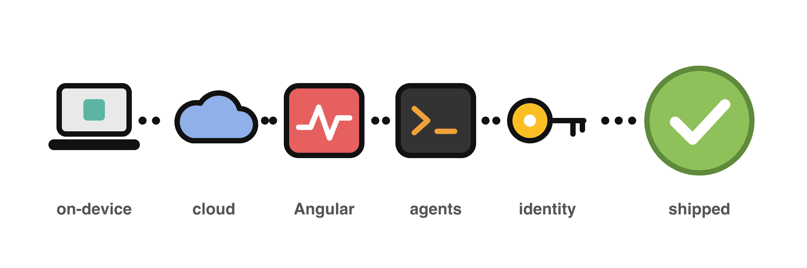

> TL;DR; 2026 was the year AI on the web stopped being a demo. Models run inside Chrome, Gemini falls back to the cloud with one SDK, agents open real browsers, and identity became the guardrail for all of it. This post maps the year and opens a 20-post series. 🎉

### Introduction

Every year I get the same question after a talk: _"There is so much happening in AI, where do I even start?"_ This year the honest answer changed. The question is no longer "what is possible?". It's **"what actually shipped, and what is still a preview?"**

As a Google Developer Expert in Web Technologies and Identity, I spend a good part of my time reading release notes, intents to ship and docs, and then trying things in real projects. So I decided to write down my map of 2026, with one rule: if I can't point to an official source for it, it's not on the map.

I don't have all the answers, and that's not the goal of this post. The goal is to give you a picture of the territory, so the next 19 posts make sense together.

### How is the series organised?

Five areas, roughly in the order a frontend team would meet them:

1. **On-device AI in Chrome**: models that run on the user's machine.
2. **Gemini in the cloud**: when the device can't, or the task is bigger.
3. **Angular and AI**: making a framework and a repo work well with agents and models.
4. **Agentic IDEs and CLIs**: tools that write, run and check your code.
5. **Identity in an agent world**: who is acting, and on whose behalf.

### What shipped in on-device AI?

This is the part I'm most excited about, because it changes the cost model of AI features.

The Summarizer, Translator and Language Detector APIs are stable in Chrome since version 138. The Prompt API, which gives you a session with the built-in language model, has been available to extensions since Chrome 138 and shipped to the web on desktop in Chrome 148. Structured output with JSON Schema works on top of it. Writer, Rewriter and Proofreader are still in trials.

Keep in mind the fine print: desktop only, with real hardware requirements, and a model download on first use. That's why **progressive enhancement is the whole game here**.

- [Built-in AI in Chrome: Summarizer, Translator and Language Detector in production](/posts/built-in-ai-in-chrome-summarizer-translator-language-detector-in-production/)
- [Structured output from the Chrome Prompt API with JSON Schema](/posts/structured-output-from-the-chrome-prompt-api-with-json-schema/)

### And when the device can't?

The cloud didn't go away; it became the fallback. Firebase AI Logic has a hybrid mode for the web (still in Preview) where one `getGenerativeModel()` call prefers Gemini Nano on the device and falls back to a cloud Gemini model. Firebase also started enforcing App Check for AI Logic in November, which is a good reminder that a cloud key in the browser needs protection.

- [Hybrid inference with Firebase AI Logic: on-device first, cloud fallback](/posts/hybrid-inference-with-firebase-ai-logic-on-device-first-cloud-fallback/)
- [Streaming Gemini responses into Angular signals](/posts/streaming-gemini-responses-into-angular-signals/)

### What did Angular do about AI?

Two things, and both matter. First, Angular teaches agents how to write modern Angular: `angular.dev` publishes `llms.txt` and `llms-full.txt`, and the Angular CLI ships an MCP server (`ng mcp`) that agents can use for best practices and project tasks. Second, the framework itself, with signals and zoneless change detection, is simply easier for an agent to reason about.

- [Angular CLI MCP server and llms.txt: teaching agents modern Angular](/posts/angular-cli-mcp-server-and-llms-txt-teaching-agents-modern-angular/)
- [Zoneless, signals and conventions: making an Angular repo agent-ready](/posts/zoneless-signals-and-conventions-making-an-angular-repo-agent-ready/)
- [Signal Forms and Gemini: AI-assisted form filling that still validates](/posts/signal-forms-and-gemini-ai-assisted-form-filling-that-still-validates/)

### Which agentic tools earned a place in my workflow?

Google Antigravity arrived in public preview in November 2025 as an agent-first development platform, and at I/O 2026 it became a full suite with a desktop app, a CLI and an SDK. Google also encouraged Gemini CLI users to migrate to the Antigravity CLI, so if your team adopted Gemini CLI, plan that move. And the Chrome DevTools MCP server, in public preview since September 2025, finally gave agents eyes: they can open a page, record a trace and look at the result.

> An agent that can't see the browser is programming with a blindfold on.

That idea comes from the Chrome DevTools team's own announcement, and it's the thread that ties these tools together: **verification**. I talked about this in my [Frontend in the AI Era](/posts/frontend-in-the-ai-era-scaling-apps-from-prompt-to-prod/) talk too.

- [Google Antigravity first impressions: agents, artifacts and browser checks](/posts/google-antigravity-first-impressions-agents-artifacts-browser-checks/)
- [From plan to verified UI: an Angular feature built in Antigravity](/posts/from-plan-to-verified-ui-an-angular-feature-built-in-antigravity/)
- [Gemini CLI for web projects: GEMINI.md, custom commands and extensions](/posts/gemini-cli-for-web-projects-gemini-md-custom-commands-and-extensions/)
- [Chrome DevTools MCP: letting agents measure your Core Web Vitals](/posts/chrome-devtools-mcp-letting-agents-measure-your-core-web-vitals/)

Two posts in this block come from my open-source work, because shipping AI features is still shipping features:

- [Feature flagging Gemini features in Angular with ngx-feature-toggle](/posts/feature-flagging-gemini-features-in-angular-with-ngx-feature-toggle/)
- [Skeleton loaders for LLM latency: ngx-skeleton-loader for streaming UIs](/posts/skeleton-loaders-for-llm-latency-ngx-skeleton-loader-for-streaming-uis/)

### Why is identity in a series about AI?

Because the moment software acts for a person, identity becomes the guardrail. This is the part of the map I care about the most as an Identity GDE.

1. **Phishing-resistant sign-in.** Passkeys matter more when agents and generated phishing pages scale attacks. The user still has to be the one who unlocks.
2. **Federation without third-party cookies.** FedCM gives the browser a mediated sign-in flow, and Sign in with Google builds on it.
3. **Proving facts, not handing over documents.** The Digital Credentials API is on by default since Chrome 141, now under `navigator.credentials.get()`, and Safari 26 supports it too.
4. **Delegation.** OAuth scopes, Agent2Agent (A2A) and the Agent Payments Protocol (AP2), announced in September 2025 as an extension of A2A, are how we describe what an agent is allowed to do.
5. **Tools for browser agents.** WebMCP proposes `document.modelContext.registerTool()` so a page can expose structured tools to agents. It's behind a flag since Chrome 146, with an origin trial approved for Chrome 149 to 156. That's early, so treat it as an experiment.

- [Passkeys in the agent era: why phishing-resistant sign-in matters more](/posts/passkeys-in-the-agent-era-why-phishing-resistant-sign-in-matters-more/)
- [FedCM and Sign in with Google: identity without third-party cookies](/posts/fedcm-and-sign-in-with-google-identity-without-third-party-cookies/)
- [Digital Credentials API: proving facts without oversharing](/posts/digital-credentials-api-proving-facts-without-oversharing/)
- [Agents acting for users: delegation, OAuth scopes, A2A and AP2](/posts/agents-acting-for-users-delegation-oauth-scopes-a2a-and-ap2/)
- [WebMCP: exposing your web app tools to browser agents](/posts/webmcp-exposing-your-web-app-tools-to-browser-agents/)

### So, what is my take?

Three opinions, with reasons:

#### 1. Default to the device, earn the cloud

On-device AI is private and free per call, but not everyone can run it. Build the feature so the local model is the fast path and the cloud is the safety net, not the other way around.

#### 2. Status labels are part of the API

Stable, origin trial, Preview, behind a flag. Read them before you promise a date to your product team. Half of the confusion I saw this year came from blog posts that ignored them.

#### 3. Agents raise the bar for verification and identity

When code and actions are generated, two questions matter more than ever: did someone check it in a real browser, and who authorised it?

And the series ends with a [2026 retrospective: what AI changed for web developers](/posts/2026-retrospective-what-ai-changed-for-web-developers/), where I'll come back to these opinions.

I'd love to hear your map too. What shipped in your team this year, and what is still a slide in a deck?

> **Ship it progressively, verify it in the browser, and know who is acting.** 🚀

### References

- [Built-in AI APIs in Chrome](https://developer.chrome.com/docs/ai/built-in-apis)
- [Intent to Ship: Prompt API (blink-dev)](https://groups.google.com/a/chromium.org/g/blink-dev/c/iR6R7-nQeHI)
- [Firebase AI Logic hybrid on-device inference](https://firebase.google.com/docs/ai-logic/hybrid-on-device-inference)
- [App Check for Firebase AI Logic](https://firebase.google.com/docs/ai-logic/app-check)
- [Angular: Build with AI and the MCP server](https://angular.dev/ai/mcp)
- [Angular: Develop with AI (llms.txt)](https://angular.dev/ai/develop-with-ai)
- [Build with Google Antigravity](https://developers.googleblog.com/en/build-with-google-antigravity-our-new-agentic-development-platform/)
- [Developer highlights from I/O 2026](https://blog.google/innovation-and-ai/technology/developers-tools/google-io-2026-developer-highlights)
- [Chrome DevTools (MCP) for your AI agent](https://developer.chrome.com/blog/chrome-devtools-mcp)
- [Digital Credentials API shipped](https://developer.chrome.com/blog/digital-credentials-api-shipped)
- [Announcing the Agent Payments Protocol (AP2)](https://cloud.google.com/blog/products/ai-machine-learning/announcing-agents-to-payments-ap2-protocol)
- [Intent to Experiment: WebMCP (blink-dev)](https://groups.google.com/a/chromium.org/g/blink-dev/c/gmYffo5WOE8/m/OJxuQRP3AAAJ)

### That’s all for today

This is the first stop of the map. Stay tuned because this is not the end, it's just the beginning.

I hope you enjoyed this reading as much as I enjoyed writing it. Thank you so much for reading until the end and see you soon!

🚀🚀🚀🚀🚀🚀

### Cya 👋
