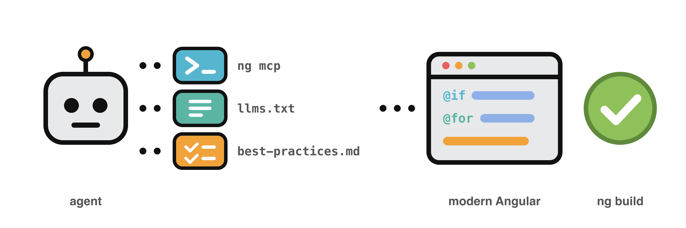

> TL;DR; Agents write the Angular they were trained on, which is often a few versions old. Plug the Angular CLI MCP server into your editor, point the agent at `llms.txt` and the official best-practices file, and it starts writing signals, native control flow and zoneless-ready code instead of `*ngIf` and NgModules. 🎉

### Introduction

Angular moved a lot between v17 and v22. Standalone became the default, `@if` and `@for` replaced the structural directives, v21 made zoneless the default for new apps, and v22 made Signal Forms and `OnPush` by default part of everyday Angular.

A model trained on years of Stack Overflow answers does not know most of that. Ask it for a component and you may still get `standalone: true`, a constructor full of injections and an `*ngFor` without tracking. It compiles, and it is exactly the code we spent the last releases migrating away from.

The Angular team's answer is to bring the knowledge to the agent instead of hoping the model catches up. In this article, we'll explore the three pieces they ship on [angular.dev/ai](https://angular.dev/ai): the CLI MCP server, the `llms.txt` files, and the best-practices and rules files.

## The Problem with "the model knows Angular"

When an agent relies only on its training data:

- it mixes APIs from different majors in the same file;
- it cannot see your workspace, so it guesses project names, test runners and build targets;
- it cannot check its own work, because it never runs `ng build` or `ng test`;
- and every developer on the team gets a slightly different flavour of "Angular", depending on the tool they use.

> The model is the engine, but the context you give it decides which Angular it writes.

## The Solution, part 1: the Angular CLI MCP server

The Angular CLI ships a [Model Context Protocol](https://modelcontextprotocol.io/) server. The angular.dev docs still describe it as experimental, so expect it to keep evolving. You start it with `ng mcp`, or through `npx` so the agent does not depend on a global install:

```json
// .vscode/mcp.json
{
  "servers": {
    "angular-cli": {
      "command": "npx",
      "args": ["-y", "@angular/cli", "mcp"]
    }
  }
}
```

The same `command` and `args` go into `.antigravity/mcp.json` or `.cursor/mcp.json`, under a `mcpServers` key instead of `servers`. Commit that file, and everyone who opens the repo gets the same setup.

Here is what the default tool set gives the agent, based on the current docs:

| Tool                        | What it does                                                               |
| :-------------------------- | :------------------------------------------------------------------------- |
| `get_best_practices`        | Loads the Angular best-practices guide, aligned to your workspace version. |
| `search_documentation`      | Searches the official docs at angular.dev.                                 |
| `list_projects`             | Reads `angular.json` and lists apps, libraries and their config.           |
| `run_target`                | Runs a configured target such as `build`, `test` or `lint`.                |
| `devserver_start` / `_stop` | Starts and stops `ng serve` in the background.                             |
| `devserver_wait_for_build`  | Returns the logs of the most recent build.                                 |
| `onpush_zoneless_migration` | Plans an `OnPush` and zoneless migration, one step at a time.              |
| `ai_tutor`                  | Starts an interactive Angular tutor.                                       |

As you can see, the list covers both halves of the problem. `get_best_practices` and `search_documentation` fix *knowledge*. `list_projects`, `run_target` and the dev server tools fix *verification*: the agent can build, test and read compiler errors instead of declaring victory early.

Two flags are worth knowing:

- `--read-only` registers only tools that do not modify the project. Great for a first trial or for review-only agents.
- `--local-only` registers only tools that do not need an internet connection.

```json
"args": ["-y", "@angular/cli", "mcp", "--read-only"]
```

## The Solution, part 2: `llms.txt` and `llms-full.txt`

Not every tool speaks MCP, and sometimes you just want to paste context into a chat. For that, angular.dev publishes two files that follow the proposed `llms.txt` standard:

- [`https://angular.dev/llms.txt`](https://angular.dev/llms.txt), an index with links to key files and resources;
- [`https://angular.dev/assets/context/llms-full.txt`](https://angular.dev/assets/context/llms-full.txt), a larger compiled set of resources on how Angular works and how to build apps with it.

Keep in mind that `llms-full.txt` is big. Use the index when the tool can follow links, and the full file when you want one self-contained context.

## The Solution, part 3: best practices and rules files

The piece I like most is [`best-practices.md`](https://angular.dev/assets/context/best-practices.md). It is short, opinionated and version-aware. Today it tells the agent, among other things, not to set `standalone: true`, not to set `OnPush` explicitly because it is the default in v22, to use `input()` and `output()` instead of decorators, to prefer native control flow, and to prefer Signal Forms for new forms.

The [Develop with AI](https://angular.dev/ai/develop-with-ai) page also links ready-made rules files per environment: `GEMINI.md` for Antigravity, an `AGENTS.md` for JetBrains IDEs, and instruction files for Copilot-powered IDEs, Cursor, VS Code and Windsurf. For new projects, `ng new` has an `--ai-config` option that generates these files for the tools you choose, for example `gemini-cli` or `vscode`.

My recommendation: do not treat these files as a black box. Copy them into the repo, read them, and add your own team rules next to them, the same way I argued in my talk recap about [agent-agnostic guardrails](/posts/frontend-in-the-ai-era-scaling-apps-from-prompt-to-prod/). The Angular files tell the agent how modern Angular looks. Your files tell it how *your* Angular looks.

## Conclusion

Teaching agents modern Angular is mostly a context problem, and the Angular team already solved the hard part. The MCP server gives the agent eyes and hands in the workspace, `llms.txt` gives it the docs, and the best-practices file gives it taste. The next post in this series goes one step further: [making an Angular repo agent-ready](/posts/zoneless-signals-and-conventions-making-an-angular-repo-agent-ready/) with zoneless, signals and conventions that live in the code.

## References

- [Angular: Build with AI](https://angular.dev/ai)
- [Angular CLI MCP Server](https://angular.dev/ai/mcp)
- [Angular: LLM prompts and AI IDE setup](https://angular.dev/ai/develop-with-ai)
- [Angular best-practices.md](https://angular.dev/assets/context/best-practices.md)
- [angular.dev llms.txt](https://angular.dev/llms.txt)
- [`ng new` schema (`aiConfig`) on GitHub](https://github.com/angular/angular-cli/blob/main/packages/schematics/angular/ng-new/schema.json)
- [Model Context Protocol](https://modelcontextprotocol.io/)

### That’s all for now

Give the agent the right context and the right tools, and it stops writing the Angular of five years ago.

I hope you enjoyed this reading as much as I enjoyed writing it. Thank you so much for reading until the end and see you soon!

🚀🚀🚀🚀🚀🚀

<hr />

### Cya 👋
