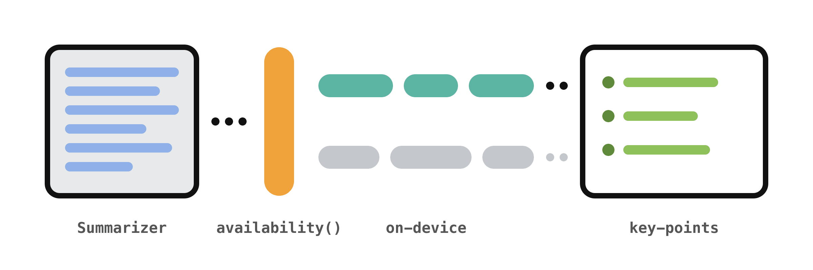

> TL;DR; The Summarizer, Translator and Language Detector APIs are stable in Chrome since version 138. Treat them as a progressive enhancement: detect, check `availability()`, show the download, and always keep a fallback. 🎉

### Introduction

This is the second post of my series _AI on the web in 2026_. If you missed the first one, [the map of the year](/posts/ai-on-the-web-in-2026-a-gde-map-of-what-shipped/) explains how the series is organised.

The task-based built-in AI APIs are the least glamorous part of the year, and probably the most useful. They don't chat. They do one job each: summarise text, translate it, or tell you which language it is in. And they do that on the user's device, without your server in the loop.

In this article, we'll go through the pattern I use to put them in production: feature detection, availability checks, download monitoring, fallbacks, and the limits you need to know before you promise anything to your product team.

## The Problem with "just call the API"

The happy path looks tiny. The real world is not. Before the first summary, you need to know that:

- The APIs run on desktop Chrome only: Windows 10 or 11, macOS 13+, Linux and Chromebook Plus. **They don't work on Android or iOS.**
- The Summarizer uses a local language model. The device needs at least 22 GB free on the volume with the Chrome profile, plus a GPU with more than 4 GB of VRAM, or a CPU with 16 GB of RAM and 4 cores.
- The Translator and Language Detector use smaller expert models, but language packs still download on demand.
- `create()` should be called after a user activation, and the APIs are not available in Web Workers.
- Cross-origin iframes need a permissions policy, like `allow="summarizer"` or `allow="translator"`.

So the question is never "does it work?". It's "does it work **for this user, right now**?".

## The Solution: detect, check, create, fall back

Every one of these APIs follows the same shape. A global (`Summarizer`, `Translator`, `LanguageDetector`), a static `availability()` that returns `"unavailable"`, `"downloadable"`, `"downloading"` or `"available"`, and a static `create()` that accepts a `monitor` callback for the download.

#### 1. Summarizer with download progress

```js
async function summarize(text, onProgress) {
  if (!('Summarizer' in self)) return serverSummary(text);

  const options = { type: 'key-points', format: 'markdown', length: 'medium' };
  const availability = await Summarizer.availability(options);
  if (availability === 'unavailable') return serverSummary(text);

  try {
    const summarizer = await Summarizer.create({
      ...options,
      sharedContext: 'Product reviews from an online store',
      monitor(m) {
        m.addEventListener('downloadprogress', (e) => onProgress(e.loaded));
      },
    });
    return await summarizer.summarize(text, {
      context: 'Keep it neutral and short.',
    });
  } catch (error) {
    console.warn('On-device summary failed', error);
    return serverSummary(text);
  }
}
```

As you can see, the built-in path is the enhancement and `serverSummary()` is the floor. That function can call your backend, a cloud model, or simply hide the feature. The important part is that the UI never depends on the local model existing.

Keep in mind that `e.loaded` goes from `0` to `1`, so you can drive a progress bar straight from it. The options can't be changed after creation, so create a new summarizer when the user picks a different `type` (`key-points`, `tldr`, `teaser` or `headline`). For long outputs, `summarizeStreaming()` returns an async iterable you can render chunk by chunk, which pairs nicely with [skeleton loaders for streaming UIs](/posts/skeleton-loaders-for-llm-latency-ngx-skeleton-loader-for-streaming-uis/).

#### 2. Language Detector before the Translator

Translation needs a source language, and users don't tell you that. So I chain the two APIs:

```js
async function translateToUserLanguage(text, targetLanguage) {
  if (!('LanguageDetector' in self) || !('Translator' in self)) return text;

  const detector = await LanguageDetector.create();
  const [top] = await detector.detect(text);
  if (!top || top.confidence < 0.6 || top.detectedLanguage === targetLanguage) {
    return text;
  }

  const pair = { sourceLanguage: top.detectedLanguage, targetLanguage };
  if ((await Translator.availability(pair)) === 'unavailable') return text;

  const translator = await Translator.create(pair);
  return translator.translate(text);
}
```

`detect()` returns a ranked list of `{ detectedLanguage, confidence }`, with confidence between `0.0` and `1.0`. The Chrome docs are honest about it: very short phrases and single words give low accuracy. The threshold above is my own choice; tune it against the languages your product cares about.

## The privacy upside (and the fine print)

> The best request is the one that never leaves the device.

The text you summarise or translate stays on the user's machine. For reviews, support tickets or any user-generated content, that is a real argument in a privacy review, and there is no per-call cost on your side.

The Translator also protects users in a subtle way: it hides which language pairs are already downloaded. Until your site creates a translator for a pair, every pair looks `downloadable`. So don't build logic that assumes `available` means "the user speaks this language".

The fine print: Summarizer output currently supports `en`, `ja`, `es`, `de` and `fr`. Outside those, fall back. And the first model download needs an unmetered connection, so don't trigger it on page load. Wait for a click that clearly says what is about to happen.

## Shipping it safely

What made these APIs boring (in the good sense) for me:

- **Gate the feature behind a flag.** Roll out to a small percentage first; [feature flagging Gemini features](/posts/feature-flagging-gemini-features-in-angular-with-ngx-feature-toggle/) covers that in Angular.
- **Measure the three paths separately**: on-device, fallback, and hidden. If most users hit the fallback, your backend is the real feature.
- **Never block the main flow on a download.** Show progress, let the user keep working.

If you want one API that switches between local and cloud for you, the next posts cover the [Prompt API with JSON Schema](/posts/structured-output-from-the-chrome-prompt-api-with-json-schema/) and [hybrid inference with Firebase AI Logic](/posts/hybrid-inference-with-firebase-ai-logic-on-device-first-cloud-fallback/).

## References

- [Built-in AI APIs overview](https://developer.chrome.com/docs/ai/built-in-apis)
- [Get started with built-in AI (hardware requirements)](https://developer.chrome.com/docs/ai/get-started)
- [Summarize with built-in AI](https://developer.chrome.com/docs/ai/summarizer-api)
- [Translation with built-in AI](https://developer.chrome.com/docs/ai/translator-api)
- [Language detection with built-in AI](https://developer.chrome.com/docs/ai/language-detection)

### That’s all for now

Built-in AI is not a replacement for your backend. It's a faster, private first option for the users who can run it.

I hope you enjoyed this reading as much as I enjoyed writing it. Thank you so much for reading until the end and see you soon!

🚀🚀🚀🚀🚀🚀

<hr />

### Cya 👋
