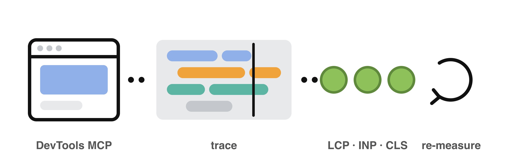

> TL;DR; With `chrome-devtools-mcp`, an agent can record a real performance trace, read the same insights you see in the DevTools Performance panel and propose a fix for LCP, INP or CLS. Give it an isolated profile, ask for evidence before changes, and re-measure after. 🎉

### Introduction

Agents are great at writing code and terrible at guessing performance. Without a browser, "this should make the page faster" is an opinion. With a trace, it's a measurement.

That's what Chrome DevTools MCP gives a coding agent: a real Chrome instance it can drive and inspect through the Model Context Protocol. If you read my [Practical Chrome DevTools: performance](/posts/practical-chrome-devtools-performance/) post, it's the same tooling, with an agent pressing the buttons.

In this article, we'll set it up, walk through a prompt flow for the three Core Web Vitals and look at the security side, which matters more than it seems.

## The Problem with agents that can't see the page

When an agent works only on source code, performance work tends to go wrong in predictable ways:

- It "optimises" things that were never on the critical path.
- It can't tell if the LCP element is an image, a heading or a late client-rendered block.
- It has no way to reproduce an interaction that feels slow.
- Nobody re-measures, so the change ships on faith.

**Performance fixes need a before and an after, and both have to come from a browser.**

## The Solution: give the agent DevTools

### Step 1 — Install the server

Most MCP clients accept the same config:

```json
{
  "mcpServers": {
    "chrome-devtools": {
      "command": "npx",
      "args": ["-y", "chrome-devtools-mcp@latest", "--isolated"]
    }
  }
}
```

The `@latest` tag keeps you on the newest version, and `--isolated` creates a temporary profile that is cleaned up when the browser closes. In Gemini CLI you can install it as an extension instead:

```sh
gemini extensions install --auto-update https://github.com/ChromeDevTools/chrome-devtools-mcp
```

Google Antigravity uses this same server for its Chrome-based browser mode, which is where performance traces and Lighthouse audits are available. I covered that in [my Antigravity first impressions](/posts/google-antigravity-first-impressions-agents-artifacts-browser-checks/).

### Step 2 — Know the tools you're asking for

The server exposes dozens of tools. These are the ones that matter for Core Web Vitals:

| Tool                          | What it does                                                    |
| ----------------------------- | --------------------------------------------------------------- |
| `performance_start_trace`     | Starts a trace; `reload` and `autoStop` cover page-load traces   |
| `performance_stop_trace`      | Stops the trace and returns the results                         |
| `performance_analyze_insight` | Digs into one insight, by `insightSetId` and `insightName`      |
| `emulate`                     | CPU throttling (`cpuThrottlingRate`) and `networkConditions`    |
| `list_network_requests`       | Lists requests, filterable by resource type                     |
| `list_console_messages`       | Lists console errors and warnings                               |
| `lighthouse_audit`            | Runs a Lighthouse audit                                         |

You don't call these yourself. You describe what you want and the agent picks the tools, but knowing the names helps you read its log and spot when it skipped a step.

### Step 3 — A prompt flow for LCP, CLS and INP

I like to split the work into "measure", "explain" and "fix", and to ask for the evidence before any code changes.

#### 1. Measure page load (LCP and CLS)

```text
Open http://localhost:4200/products. Emulate "Slow 4G" and 4x CPU throttling.
Record a performance trace with a page reload. Report LCP and CLS, the LCP element,
and the list of insights. Don't change any code yet.
```

A reload trace gives the agent load metrics plus insights such as LCP subparts and LCP request discovery. Then it can call `performance_analyze_insight` to get the details behind one of them.

#### 2. Measure an interaction (INP)

INP needs a real interaction, so the reload trace alone is not enough:

```text
Start a trace without reloading. Click the "Add to cart" button on the first product,
then stop the trace. Report the interaction's INP and break it down into
input delay, processing time and presentation delay.
```

The agent uses `click` (or `fill`, `press_key`) between `performance_start_trace` and `performance_stop_trace`, so the interaction lands inside the trace.

#### 3. Explain, then fix, then re-measure

```text
Based on the insights, propose the smallest change that improves the worst metric.
Explain which insight it addresses. After I approve it, apply the change
and record the same trace again with the same throttling. Compare before and after.
```

As you can see, the same throttling settings are part of the prompt. Comparing a throttled "before" with an unthrottled "after" is the easiest way to fool yourself.

> No trace, no fix. No second trace, no merge.

Keep in mind that a local trace is lab data. It tells you what happens on your machine with these settings, not what your users experience. By default, the performance tools may send trace URLs to the Chrome UX Report (CrUX) API to fetch field data for comparison, which is useful for public pages. For internal or staging URLs, turn it off with `--no-performance-crux`.

## The security part: whose browser is this?

Here's what I'd like every team to read before enabling this.

The server "exposes content of the browser instance to the MCP clients". Whatever the browser can see, the agent can see.

- **Default**: the server launches Chrome with its own profile at `$HOME/.cache/chrome-devtools-mcp/chrome-profile`. That's separate from your daily profile, but it is not cleared between runs, so logins persist.
- **`--isolated`**: a temporary profile, deleted after the browser closes. My default for performance work.
- **`--autoConnect`** (Chrome 144+, with remote debugging enabled at `chrome://inspect/#remote-debugging`): connects to the Chrome you already have open. The docs note it connects to the default profile and has access to all of its open windows. That means your email, your admin dashboards and your sessions.

So my rules are simple:

- Use `--isolated` unless you truly need state, and then use a dedicated test account.
- Never point the agent at a profile signed in to production admin tools.
- Restrict where it can go with `--allowedUrlPattern` (Chrome 149+) or `--blockedUrlPattern`.
- Opt out of usage statistics with `--no-usage-statistics` if your policy needs it.

### Conclusion

Chrome DevTools MCP turns performance work with agents from guessing into measuring. Ask for traces, read the insights, re-measure with the same settings, and keep the browser isolated. The agent does the clicking; you keep the judgement.

## References

- [Chrome DevTools MCP on GitHub](https://github.com/ChromeDevTools/chrome-devtools-mcp)
- [Chrome DevTools MCP tool reference](https://github.com/ChromeDevTools/chrome-devtools-mcp/blob/main/docs/tool-reference.md)
- [Chrome DevTools MCP configuration](https://github.com/ChromeDevTools/chrome-devtools-mcp/blob/main/docs/configuration.md)
- [Chrome DevTools MCP advanced usage](https://github.com/ChromeDevTools/chrome-devtools-mcp/blob/main/docs/advanced-usage.md)
- [Chrome DevTools (MCP) for your AI agent](https://developer.chrome.com/blog/chrome-devtools-mcp)
- [Performance features reference](https://developer.chrome.com/docs/devtools/performance/reference)
- [Antigravity docs: Browser use](https://antigravity.google/docs/browser)
- [Web Vitals](https://web.dev/articles/vitals)

### That’s all for now

Let the agent collect the numbers, and stay the one who decides what "fast enough" means.

I hope you enjoyed this reading as much as I enjoyed writing it. Thank you so much for reading until the end and see you soon!

🚀🚀🚀🚀🚀🚀

<hr />

### Cya 👋
