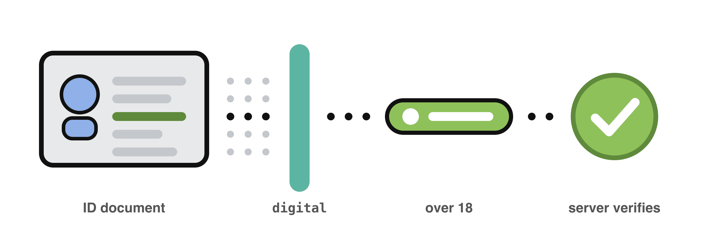

> TL;DR; Stop asking people to upload a photo of their ID. With `navigator.credentials.get({ digital })` you ask a wallet for the one signed claim you need (for example `age_equal_or_over.18`), the user approves it in browser UI, and your server verifies the signature and the issuer. 🎉

_This post is part of my series "AI on the web in 2026". Start with [the map of the year](/posts/ai-on-the-web-in-2026-a-gde-map-of-what-shipped/) if you want the big picture._

### Introduction

If you've built a sign-up flow for anything age-restricted, regulated or high-value, you know the drill: a file input, a "take a photo of your ID" step, and a back office that now stores date of birth, address, document number and a face. All of that to answer one yes/no question.

Neither side likes it. The user overshares, and the developer inherits a pile of sensitive data that has to be stored, secured and eventually deleted.

**The Digital Credentials API flips this: you ask for a fact, not a document.**

In this post, I'll walk through the request shape that shipped, the protocols behind it, what your server still has to do, where it works today, and why this matters a lot more now that agents are filling forms on behalf of people.

### Where it stands at the end of 2026

Let's start with the status, because this API changed shape during its origin trial:

- **Chrome 141** enabled the Digital Credentials API by default, with same-device presentation on Android and cross-device presentation on desktop Chrome (scan a QR code, and the phone and the desktop connect over the FIDO CTAP protocol with a BLE proximity check).
- **Safari 26** (macOS, iOS and iPadOS 26) supports it with the `org-iso-mdoc` protocol, for mobile IDs in Apple Wallet and third-party wallets. iOS 26 also brings it to Chrome and other browsers on iOS.
- The spec is a **W3C Working Draft**, so details can still move.

If you tried the origin trial, note the rename: `navigator.identity.get()` became `navigator.credentials.get()`, `providers` became `requests`, and `request` became `data`. The API now sits next to passkeys and federated credentials in the Credential Management family.

### Step 1 — Feature detection

Show the "Verify with a digital ID" button only when the browser can actually handle it, and only for protocols it allows:

```javascript
const canUseDigitalCredentials =
  typeof DigitalCredential !== 'undefined' &&
  DigitalCredential.userAgentAllowsProtocol('openid4vp-v1-unsigned');

if (!canUseDigitalCredentials) {
  // Keep your existing verification flow as the fallback.
}
```

The spec registers four protocol identifiers today: `openid4vp-v1-unsigned`, `openid4vp-v1-signed`, `openid4vp-v1-multisigned` and `org-iso-mdoc`. The first three are OpenID for Verifiable Presentations (OpenID4VP), and the last one is the ISO 18013-7 Annex C flow for mdocs (mobile driving licences and similar IDs). Chrome is protocol-agnostic and accepts both families. Safari speaks `org-iso-mdoc`.

### Step 2 — Ask for one claim

Here is the part I like most. With OpenID4VP, you describe what you need with a DCQL query (Digital Credentials Query Language). This example asks for a European PID credential and only the "18 or older" claim:

```javascript
async function verifyAge() {
  // The nonce comes from your server and is bound to this session.
  const { nonce, clientMetadata } = await fetch('/verify/start').then((r) => r.json());

  try {
    const credential = await navigator.credentials.get({
      digital: {
        requests: [
          {
            protocol: 'openid4vp-v1-unsigned',
            data: {
              response_type: 'vp_token',
              nonce,
              client_metadata: clientMetadata, // vp_formats_supported + jwks for encryption
              dcql_query: {
                credentials: [
                  {
                    id: 'pid',
                    format: 'dc+sd-jwt',
                    meta: { vct_values: ['urn:eudi:pid:1'] },
                    claims: [{ path: ['age_equal_or_over', '18'] }],
                  },
                ],
              },
            },
          },
        ],
      },
    });

    // credential.protocol + credential.data go to the backend, untouched.
    return fetch('/verify/finish', {
      method: 'POST',
      headers: { 'Content-Type': 'application/json' },
      body: JSON.stringify({ protocol: credential.protocol, data: credential.data }),
    });
  } catch (error) {
    // The user cancelled, no wallet had a match, or the request was rejected.
    console.error(error);
  }
}
```

As you can see, there is no "give me the whole document" here. The wallet shows the user exactly what is being requested, and with selective disclosure only that claim leaves the device. No date of birth, no address, no document number.

> Ask for the answer, not the document. Data you never receive is data you never have to protect 🔐

Keep in mind that the API is also compatible with zero-knowledge proof protocols, such as Google's Longfellow ZK, where the response is a cryptographic proof that the assertion is true without revealing anything else.

### Step 3 — Verify on the server, not in the browser

The browser hands you an encrypted blob. For `openid4vp-v1-unsigned`, `credential.data.response` is a JWE; for `org-iso-mdoc`, the response uses Hybrid Public Key Encryption. Your backend has three jobs:

#### 1. Decrypt the response

Use the private key that matches the `jwks` you sent in `client_metadata`. The decrypted payload carries the presentation in the `vp_token` claim.

#### 2. Verify signatures and bindings

Check the issuer's signature, the holder binding, and that the `nonce` matches the one you issued for this session. A valid signature on a replayed presentation is still a replay.

#### 3. Decide whether you trust the issuer

This is the step people skip. A signature proves the credential is authentic. It does not prove the issuer is appropriate for your use case. Keep an allowlist of issuers you accept, and reject everything else.

Never make the access decision in the browser. The front end requests and forwards; the server decides.

### Why this matters when agents fill forms

This is where the API connects to the rest of this series. In 2026, a lot of form filling moved to agents: browser agents, [WebMCP tools](/posts/webmcp-exposing-your-web-app-tools-to-browser-agents/), [AI-assisted Signal Forms](/posts/signal-forms-and-gemini-ai-assisted-form-filling-that-still-validates/). That's great for a shipping address. It's a terrible pattern for identity.

Think about the "upload your ID" flow in an agent world. For an agent to complete it, the document image has to be somewhere the agent can read it. Now the user's most sensitive document is part of a model's context.

The Digital Credentials API has a much better shape for this:

- **The user approves in browser and wallet UI.** The spec requires transient activation (a real user gesture) and makes user mediation required, so a page cannot quietly pull a credential in the background.
- **The claim is signed by an issuer.** An agent can't type "yes, I'm over 18" into a field and have it count. The proof comes from the wallet, not from text a model produced.
- **Minimal disclosure is the default.** Even when an agent is helping with the rest of the form, it only ever sees the outcome your server returns, not the document.

So my advice is simple: let agents help with the boring fields, and keep facts about a person behind a credential the person presents. This also pairs nicely with [passkeys for phishing-resistant sign-in](/posts/passkeys-in-the-agent-era-why-phishing-resistant-sign-in-matters-more/) and [FedCM for federated identity](/posts/fedcm-and-sign-in-with-google-identity-without-third-party-cookies/). And even agent payment protocols are reaching for it: AP2's authorization framework recommends the Digital Credentials API, where available, for users to approve mandates (more in [my post about delegation](/posts/agents-acting-for-users-delegation-oauth-scopes-a2a-and-ap2/)).

### What this gives you

- **Less data to store**, which means a smaller breach surface and fewer deletion obligations.
- **A better UX**: no camera step, no blurry photo, no manual review queue for the happy path.
- **Cross-device by design**: desktop users present from their phone with a QR code.
- **An honest fallback**: feature-detect, and keep your current flow for browsers or users without a compatible wallet.

The ecosystem is still young. Wallet coverage varies by country and issuer, and the spec is still a Working Draft. Start with one flow where you currently ask for a document scan, and measure how many users can take the new path.

### References & Further Reading

- [Digital Credentials API: Secure and private identity on the web (Chrome for Developers)](https://developer.chrome.com/blog/digital-credentials-api-shipped)
- [W3C Digital Credentials specification](https://www.w3.org/TR/digital-credentials/)
- [Digital Credentials developer guide](https://digitalcredentials.dev/)
- [WebKit features in Safari 26.0 — Digital Credentials API](https://webkit.org/blog/17333/webkit-features-in-safari-26-0/#digital-credentials-api)
- [OpenID for Verifiable Presentations 1.0](https://openid.net/specs/openid-4-verifiable-presentations-1_0-final.html)
- [Online acceptance of digital credentials (Google Wallet)](https://developers.google.com/wallet/identity/verify/accepting-ids-from-wallet-online)
- [Multipaz verifier demo](https://verifier.multipaz.org/)
- [Frontend in the AI Era — scaling apps from prompt to prod](/posts/frontend-in-the-ai-era-scaling-apps-from-prompt-to-prod/)

### That’s all for now

Identity is the one part of a form I don't want any agent to "fill in". Ask for a signed fact, verify it on the server, and keep the rest of the person's data where it belongs: with them.

I hope you enjoyed this reading as much as I enjoyed writing it. Thank you so much for reading until the end and see you soon!

🚀🚀🚀🚀🚀🚀

<hr />

### Cya 👋
