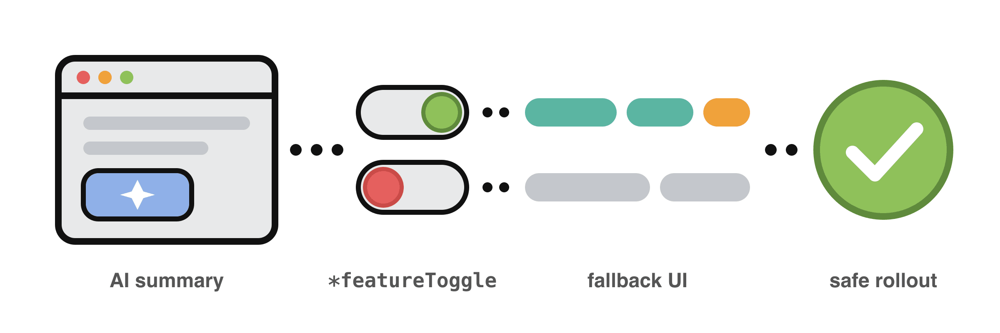

> TL;DR; Treat every AI feature as a release you can turn off. Put it behind `*featureToggle`, guard its routes with `featureToggleGuard`, flip it at runtime with `FeatureToggleService`, and always render something useful when the model is not available 🎉

### Introduction

If 2026 taught me one thing about AI features on the web, it is that they fail in more ways than a regular feature. The model can be slow, expensive, wrong, or simply not on the device yet. Built-in AI in Chrome, like the [Summarizer API](https://developer.chrome.com/docs/ai/summarizer-api) running Gemini Nano, downloads the model on first use, and some devices will never meet the hardware requirements. Cloud models have quotas and bills.

None of that is a reason to avoid shipping. It is a reason to ship with a switch in your hand.

In this article, we'll explore how to put a Gemini-powered "Summarize" button behind a feature toggle in Angular using [ngx-feature-toggle](https://github.com/willmendesneto/ngx-feature-toggle), roll it out gradually, keep a kill switch, and render a fallback UI when the model is unavailable. If you want the background on the library itself, I wrote about it in [NGX-Feature-Toggle — Flexible User Management and Page Access control](/posts/ngx-feature-toggle-flexible-user-management-and-page-access-control-for-angular-apps/).

## The Problem with shipping AI features "always on"

Picture a summary button on an article page. It works on your machine. Then it reaches production and:

- some users see a button that does nothing, because their device can't run the on-device model;
- a prompt change makes the output worse, and you need a full deploy to roll it back;
- cloud usage grows faster than the budget, and the only lever is a hotfix;
- a new "AI lab" page is reachable by URL before it's ready.

> An AI feature without a kill switch is an incident waiting for a deploy window.

## The Solution: toggles in templates, routes and at runtime

The latest `ngx-feature-toggle` (v13 at the time of writing) is built around standalone APIs and signals, and it requires Angular 22 or newer. Older apps can keep using the previous major versions.

#### 1. Safe defaults at bootstrap

Start with every AI flag **off**. If the remote configuration never arrives, users get the classic experience instead of a broken one.

```typescript
// app.config.ts
import { ApplicationConfig, inject, provideAppInitializer } from '@angular/core';
import { provideRouter } from '@angular/router';
import { FeatureToggleService, provideFeatureToggles } from 'ngx-feature-toggle';
import { routes } from './app.routes';

export const appConfig: ApplicationConfig = {
  providers: [
    provideRouter(routes),
    provideFeatureToggles({
      enableAiSummary: false,
      enableAiLab: false,
      aiKillSwitch: false,
    }),
    provideAppInitializer(async () => {
      const toggles = inject(FeatureToggleService);
      try {
        const response = await fetch('/api/feature-toggles');
        if (response.ok) {
          toggles.set(await response.json());
        }
      } catch {
        // Network error: keep the safe defaults, AI features stay off.
      }
    }),
  ],
};
```

As you can see, `FeatureToggleService.set()` merges the values coming from the server with the defaults. The gradual rollout lives on the server: it decides, per user or per percentage bucket, whether `enableAiSummary` is `true`. The frontend only consumes booleans, which keeps the rollout logic in one place.

#### 2. The template: feature, kill switch and fallback

`*featureToggle` accepts a single name, a `!` prefix for negation, or an array where **all** entries must match. That array is a nice fit for a kill switch:

```typescript
import { Component, input } from '@angular/core';
import { FeatureToggleDirective } from 'ngx-feature-toggle';
import { AiSummaryComponent } from './ai-summary.component';

@Component({
  selector: 'app-article',
  imports: [FeatureToggleDirective, AiSummaryComponent],
  template: `
    <ng-container *featureToggle="['enableAiSummary', '!aiKillSwitch']">
      <app-ai-summary [text]="body()" />
    </ng-container>
    <ng-container *featureToggle="'aiKillSwitch'">
      <p>Summaries are paused for now. The full article is below.</p>
    </ng-container>
    <article [innerHTML]="body()"></article>
  `,
})
export class ArticleComponent {
  readonly body = input.required<string>();
}
```

The kill switch is a separate flag on purpose. `enableAiSummary` describes the rollout, while `aiKillSwitch` describes an incident. When you turn the incident off, the rollout state is still there.

#### 3. Flip it at runtime

`FeatureToggleService` exposes the toggles as a signal, and every `*featureToggle` updates when they change, also in `OnPush` and zoneless apps. So that, a kill switch can arrive through Server-Sent Events, without a reload:

```typescript
import { Injectable, inject } from '@angular/core';
import { FeatureToggleService } from 'ngx-feature-toggle';

@Injectable({ providedIn: 'root' })
export class FeatureToggleStream {
  private readonly toggles = inject(FeatureToggleService);

  connect() {
    const events = new EventSource('/api/feature-toggles/stream');
    events.onmessage = (event) => {
      try {
        this.toggles.set(JSON.parse(event.data));
      } catch {
        // Ignore malformed messages and keep the current toggles.
      }
    };
    events.onerror = () => events.close();
  }
}
```

#### 4. Guard the routes

For a whole page, like an experimental "AI lab", use `featureToggleGuard` with `canMatch`. The route data takes the same string, array or callback syntax, and `redirectTo` sends users somewhere useful:

```typescript
import { Routes } from '@angular/router';
import { featureToggleGuard } from 'ngx-feature-toggle';

export const routes: Routes = [
  {
    path: 'ai-lab',
    loadComponent: () => import('./ai-lab/ai-lab.component').then((m) => m.AiLabComponent),
    canMatch: [featureToggleGuard],
    data: {
      featureToggle: ['enableAiLab', '!aiKillSwitch'],
      redirectTo: '/',
    },
  },
];
```

#### 5. A flag is not a capability check

Keep in mind: the flag says "you _may_ show this". It doesn't say "this device _can_ run it". The component behind the flag still checks the model. With the Summarizer API, `availability()` returns `"unavailable"`, `"downloadable"`, `"downloading"` or `"available"`, and the [Chrome docs](https://developer.chrome.com/docs/ai/inform-users-of-model-download) recommend showing download progress for the middle two.

```typescript
import { Component, input, signal } from '@angular/core';
// Typings: npm install -D @types/dom-chromium-ai

type SummaryState = 'idle' | 'downloading' | 'ready' | 'unavailable' | 'error';

@Component({
  selector: 'app-ai-summary',
  template: `
    @switch (state()) {
      @case ('unavailable') {
        <a href="#key-points">Jump to the key points</a>
      }
      @case ('downloading') {
        <p>Preparing the on-device model… {{ progress() }}%</p>
      }
      @case ('error') {
        <p>We couldn't summarize this article. The full text is below.</p>
      }
      @default {
        <button type="button" (click)="summarize()">Summarize</button>
        <p>{{ summary() }}</p>
      }
    }
  `,
})
export class AiSummaryComponent {
  readonly text = input.required<string>();
  readonly state = signal<SummaryState>('idle');
  readonly progress = signal(0);
  readonly summary = signal('');

  async summarize() {
    const availability = 'Summarizer' in self ? await Summarizer.availability() : 'unavailable';
    if (availability === 'unavailable') {
      this.state.set('unavailable');
      return;
    }
    try {
      if (availability !== 'available') this.state.set('downloading');
      const summarizer = await Summarizer.create({
        type: 'tldr',
        monitor: (m) =>
          m.addEventListener('downloadprogress', (e) => this.progress.set(Math.round(e.loaded * 100))),
      });
      this.state.set('ready');
      this.summary.set(await summarizer.summarize(this.text()));
    } catch {
      this.state.set('error');
    }
  }
}
```

`Summarizer.create()` runs inside the click handler because the model download needs user activation. The same shape works for a cloud fallback: swap the `'unavailable'` branch for a call to your Gemini backend, and give that call its own flag so you can turn off the paid path without touching the free on-device one.

### What this gives you

- **Gradual rollout** decided on the server and consumed as booleans.
- **A kill switch** that reaches open tabs without a deploy.
- **Fallback UI** for devices that can't run the model, and for errors.
- **Routes** that stay closed until the feature is ready.

And, like any release toggle, plan its removal. Once the feature is stable, delete the flag and the dead branch. I wrote about [automating that cleanup](/posts/automating-launchdarkly-feature-flags-cleanup-in-your-codebase/) a while ago, and the advice still holds.

If you're streaming the response instead of waiting for the whole summary, take a look at [Streaming Gemini responses into Angular signals](/posts/streaming-gemini-responses-into-angular-signals/) and [Skeleton loaders for LLM latency](/posts/skeleton-loaders-for-llm-latency-ngx-skeleton-loader-for-streaming-uis/) in this series.

## References

- [ngx-feature-toggle on GitHub](https://github.com/willmendesneto/ngx-feature-toggle)
- [ngx-feature-toggle on npm](https://www.npmjs.com/package/ngx-feature-toggle)
- [Summarize with built-in AI (Summarizer API)](https://developer.chrome.com/docs/ai/summarizer-api)
- [Inform users of model download](https://developer.chrome.com/docs/ai/inform-users-of-model-download)
- [Route guards on angular.dev](https://angular.dev/guide/routing/route-guards)
- [Feature Toggles, by Martin Fowler](https://martinfowler.com/bliki/FeatureToggle.html)

### That’s all for now

Ship the AI feature, but ship the switch first.

I hope you enjoyed this reading as much as I enjoyed writing it. Thank you so much for reading until the end and see you soon!

🚀🚀🚀🚀🚀🚀

<hr />

### Cya 👋
