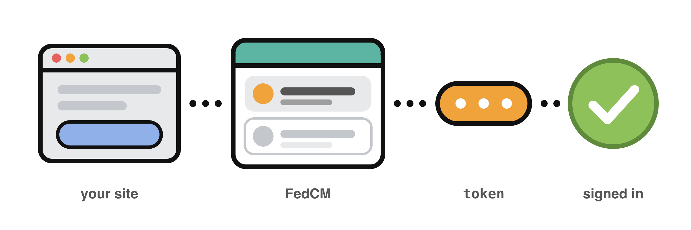

> TL;DR; FedCM lets the browser, not a hidden iframe, broker federated sign-in, and it works without third-party cookies. If you use Google Identity Services, the library handles it for One Tap, and the button flow is one flag away: `use_fedcm_for_button: true` 🎉

### Introduction

Third-party cookies had a busy story in 2025. Google first said [in April](https://privacysandbox.google.com/blog/privacy-sandbox-next-steps) that Chrome would keep its current approach to third-party cookie choice and would not ship a standalone prompt. Then, in [October](https://privacysandbox.google.com/blog/update-on-plans-for-privacy-sandbox-technologies), it retired most Privacy Sandbox APIs, like Topics and Protected Audience.

So, is FedCM still relevant if cookies are not going away? Yes. In that same October post, FedCM is one of the few APIs Google decided to keep, because it "has seen broad adoption, including support from other browsers". Users can still block third-party cookies, Incognito blocks them by default, and federated sign-in has to keep working in all those cases.

In this article, we'll explore the FedCM API basics, the Google Identity Services (GIS) migration and why I think browser-mediated identity is even more important now that browsers and agents mediate more of our flows.

## The Problem with cookie-based federation

The classic "Sign in with an identity provider" button relies on iframes, redirects or third-party cookies. That brings some known issues:

- the identity provider can't tell who you are inside a cross-site iframe when third-party cookies are blocked;
- the same mechanism that powers sign-in can be used to track users across sites;
- the UI is painted by a page, so users (and any automation looking at the page) can't easily tell a real prompt from a lookalike.

## The Solution: let the browser broker the sign-in

[FedCM](https://developer.chrome.com/docs/identity/fedcm/overview) (Federated Credential Management) is a browser API for federated sign-in that works without third-party cookies or navigational redirects. The browser shows its own account chooser and only contacts the identity provider on the user's behalf after explicit consent.

#### 1. FedCM in a few lines

For a relying party, the core is `navigator.credentials.get()` with an `identity` option:

```javascript
async function signInWithIdp() {
  if (!('IdentityCredential' in window)) {
    return redirectToClassicSignIn(); // FedCM isn't available in every browser
  }

  try {
    const credential = await navigator.credentials.get({
      identity: {
        context: 'signin',
        providers: [
          {
            configURL: 'https://idp.example/fedcm.json',
            clientId: 'your-client-id',
            params: { nonce: crypto.randomUUID() },
          },
        ],
      },
      mediation: 'optional',
    });
    // credential.token goes to your server, which validates it with the IdP.
    await fetch('/auth/fedcm', { method: 'POST', body: credential.token });
  } catch (error) {
    // User dismissed the dialog, has no account, or FedCM is disabled.
    return redirectToClassicSignIn();
  }
}
```

As you can see, a few details carry most of the behaviour:

- `configURL` points to the identity provider's config file, and `clientId` is the ID the provider issued to you;
- `params` carries custom values to the provider, like a `nonce` for replay protection;
- `mediation: 'optional'` (the default) lets the browser re-authenticate a returning user automatically when possible, while `'silent'` never shows UI and `'required'` always asks;
- `context` changes the dialog wording to `signin`, `signup` or `use`.

When the user signs out explicitly, call `navigator.credentials.preventSilentAccess()` so they aren't signed back in automatically. And if FedCM runs inside a cross-origin iframe, the parent needs `allow="identity-credentials-get"` on the `iframe`.

> The browser owns the prompt. That's the whole point.

#### 2. Sign in with Google: what changed with GIS

If you use Google, you shouldn't call FedCM by hand. The [GIS JavaScript library](https://developers.google.com/identity/gsi/web/guides/fedcm-migration) does it for you, and for most sites the migration happened through backward compatible updates to the library.

Two things to know:

- **One Tap** no longer has an opt-in: the old `use_fedcm_for_prompt` flag is deprecated and ignored, according to the [JavaScript API reference](https://developers.google.com/identity/gsi/web/reference/js-reference). You can delete it from your config.
- **The button flow** is opt-in with `use_fedcm_for_button`, which defaults to `false` and applies to Chrome on desktop (M125+) and Android (M128+).

```javascript
window.onload = () => {
  google.accounts.id.initialize({
    client_id: 'YOUR_CLIENT_ID.apps.googleusercontent.com',
    callback: async ({ credential }) => {
      // `credential` is an ID token. Always verify it on the server.
      const response = await fetch('/auth/google', { method: 'POST', body: credential });
      if (!response.ok) showSignInError();
    },
    use_fedcm_for_button: true,
  });

  google.accounts.id.renderButton(document.getElementById('google-button'), {
    theme: 'outline',
    size: 'large',
  });
  google.accounts.id.prompt(); // One Tap
};
```

#### 3. Clean up the old One Tap code

The migration guide lists a few things to remove, because the browser now controls the prompt:

- calls to `isDisplayMoment()`, `isDisplayed()`, `isNotDisplayed()`, `getNotDisplayedReason()` and `getSkippedReason()`;
- custom `position` styles for the One Tap container, since the browser decides the size and placement;
- missing `allow="identity-credentials-get"` on parent iframes when One Tap or the button runs cross-origin.

Keep in mind that, with FedCM, One Tap shows the top-level site's domain, and Chrome's "Third-party sign-in" setting affects One Tap but not the FedCM button flow.

## Why this matters more with browsers and agents in the middle

Looking back at this year, more and more flows went through something other than the user's own clicks: browser assistants, agents filling forms, automation running in a tab.

In that world, I see a browser-owned identity prompt as a big advantage. It's a consistent surface the human recognises and confirms, it isn't painted by the page, and the identity provider gets nothing until the user says yes. That's the same principle I argued for with [passkeys in the agent era](/posts/passkeys-in-the-agent-era-why-phishing-resistant-sign-in-matters-more/): the agent can do the task, but the human approves who they are. FedCM brings that principle to federated sign-in.

The next step in this direction is proving facts without sharing the whole identity, which I cover in [Digital Credentials API: proving facts without oversharing](/posts/digital-credentials-api-proving-facts-without-oversharing/).

## References

- [Next steps for Privacy Sandbox and tracking protections in Chrome](https://privacysandbox.google.com/blog/privacy-sandbox-next-steps)
- [Update on plans for Privacy Sandbox technologies](https://privacysandbox.google.com/blog/update-on-plans-for-privacy-sandbox-technologies)
- [FedCM overview (Chrome for Developers)](https://developer.chrome.com/docs/identity/fedcm/overview)
- [Implement an identity solution with FedCM on the relying party side](https://developer.chrome.com/docs/identity/fedcm/implement/relying-party)
- [Migrate to FedCM (Google Identity Services)](https://developers.google.com/identity/gsi/web/guides/fedcm-migration)
- [Google Identity Services JavaScript API reference](https://developers.google.com/identity/gsi/web/reference/js-reference)

### That’s all for now

Third-party cookies may stay, but sign-in shouldn't depend on them.

I hope you enjoyed this reading as much as I enjoyed writing it. Thank you so much for reading until the end and see you soon!

🚀🚀🚀🚀🚀🚀

<hr />

### Cya 👋
