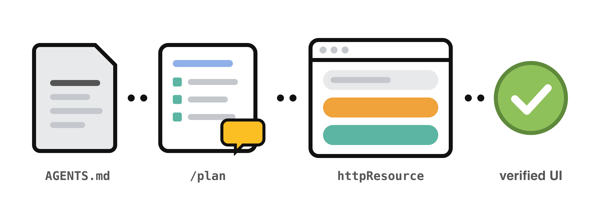

> TL;DR; Give the agent your conventions, review the implementation plan before any code exists, let the browser agent check the UI states, and finish with your own diff review. Using a loading state in an Angular component as the example, this is the workflow I recommend in Antigravity. 🎉

### Introduction

In [my first impressions of Google Antigravity](/posts/google-antigravity-first-impressions-agents-artifacts-browser-checks/) I said the value is in the evidence the agent hands back. This post makes that concrete.

The example is small on purpose: a product list component that shows nothing while data loads. We want a loading state, an error state and the list itself. Small enough to read in one sitting, but it has UI states that unit tests rarely look at.

Keep in mind this is a **recommended workflow**, not a case study. The steps work with any surface that has implementation plans and browser use: the Antigravity App, the IDE or the CLI.

## The Problem with "just build it"

If you prompt "add a loading state to the product list" and accept whatever comes back, a few things tend to happen:

- The agent picks a pattern your repo doesn't use (a `BehaviorSubject`, a zone-based workaround, a new spinner library).
- The happy path works, but the error and empty states are missing.
- Nobody looks at the page on a slow network, which is the only place a loading state matters.

None of these are bugs the compiler will catch. **They are decisions, and decisions belong in the plan.**

## The Solution: five steps, one loop

### Step 1 — Put your conventions where the agent reads them

Antigravity loads `AGENTS.md` (or `GEMINI.md`) from your workspace up to the repository root and keeps it always active. So the conventions go there, not in every prompt:

```markdown
## Angular conventions

- Standalone components, `ChangeDetectionStrategy.OnPush`, signals for state.
- Fetch data with `httpResource`; never subscribe manually in components.
- Use built-in control flow (`@if`, `@for`), not structural directives.
- Every async view handles loading, error and empty states.
- Run `npm run lint` and `npm test` before saying a task is done.
```

If your repo is not there yet, [making an Angular repo agent-ready](/posts/zoneless-signals-and-conventions-making-an-angular-repo-agent-ready/) covers what to write.

### Step 2 — Ask for a plan, with an acceptance check

Use the `/plan` slash command so the agent stops after planning:

```text
/plan Add loading, error and empty states to ProductListComponent
(src/app/products/product-list.component.ts).
Acceptance: on a slow network a loading indicator is visible,
a failed request shows a retry button, and the list renders after load.
Verify in the browser at http://localhost:4200/products and add screenshots
of each state to the walkthrough.
```

The acceptance check is the important part. It gives the browser step something to verify later.

### Step 3 — Comment on the implementation plan

The agent answers with an implementation plan Artifact: goal, proposed changes, files. This is where you review, because changing a sentence is cheaper than changing a diff.

Things I look for:

- Does it follow `AGENTS.md`, or did it sneak in a new dependency?
- Are all three states listed, including retry?
- Is the scope limited to the files we expect?

Leave comments inline, like on a doc. They are attached to your next message, and the agent only continues when you click **Proceed**. If you want the agent to always stop at plans and diffs, set _Plan Review Policy_ to **Always Ask**.

> The plan is the cheapest place to say "no". Use it.

### Step 4 — Let the agent write the code

With the plan approved, the agent edits the component. A result that follows the conventions above could look like this:

```typescript
import { ChangeDetectionStrategy, Component } from '@angular/core';
import { httpResource } from '@angular/common/http';

interface Product {
  id: string;
  name: string;
}

@Component({
  selector: 'app-product-list',
  changeDetection: ChangeDetectionStrategy.OnPush,
  template: `
    @if (products.isLoading()) {
      <p role="status">Loading products…</p>
    } @else if (products.error()) {
      <p role="alert">We couldn't load the products.</p>
      <button type="button" (click)="products.reload()">Try again</button>
    } @else if (products.hasValue()) {
      <ul>
        @for (product of products.value(); track product.id) {
          <li>{{ product.name }}</li>
        } @empty {
          <li>No products yet.</li>
        }
      </ul>
    }
  `,
})
export class ProductListComponent {
  readonly products = httpResource<Product[]>(() => '/api/products');
}
```

As you can see, `httpResource` already exposes `isLoading()`, `error()`, `hasValue()`, `value()` and `reload()` as signals or methods, so the template stays declarative. It is stable since Angular v22; on older versions check its status first. If you want something nicer than a text line, [skeleton loaders for LLM latency](/posts/skeleton-loaders-for-llm-latency-ngx-skeleton-loader-for-streaming-uis/) shows how to plug in `ngx-skeleton-loader`.

### Step 5 — Browser check, then your own review

Now the agent opens the page. In the App's built-in browser or through `/browser` in Chrome, it can click, take screenshots, check responsive layouts and read console errors and failed network requests. Antigravity asks you to approve `localhost` per port the first time.

The Chrome-based mode runs on the Chrome DevTools MCP server, which can also emulate network conditions such as `Slow 3G`. That's handy for actually seeing the loading state instead of a flash.

When the agent finishes, read the walkthrough with the screenshots of each state. Then do the part that is still yours:

- Open the diff and read it, not only the summary.
- Run `npm run lint` and `npm test` locally.
- Reproduce the error state yourself, for example by blocking `/api/products` in DevTools.

If something is off, comment and send it back. The loop is the same: plan, code, check, review.

### Conclusion

The workflow is boring in a good way. Conventions live in the repo, decisions happen in the plan, evidence comes from the browser, and accountability stays with you. Swap the Angular component for any UI change and the steps still hold.

## References

- [Antigravity docs: Rules](https://antigravity.google/docs/rules)
- [Antigravity docs: Implementation plan](https://antigravity.google/docs/implementation-plan)
- [Antigravity docs: Artifact review](https://antigravity.google/docs/artifact-review)
- [Antigravity docs: Walkthrough](https://antigravity.google/docs/walkthrough)
- [Antigravity docs: Browser use](https://antigravity.google/docs/browser)
- [Angular: httpResource API](https://angular.dev/api/common/http/httpResource)
- [Angular: Async reactivity with resources](https://angular.dev/guide/signals/resource)
- [Chrome DevTools MCP tool reference](https://github.com/ChromeDevTools/chrome-devtools-mcp/blob/main/docs/tool-reference.md)

### That’s all for now

Take that as some food for thought: the faster the agent writes, the more your review is worth.

I hope you enjoyed this reading as much as I enjoyed writing it. Thank you so much for reading until the end and see you soon!

🚀🚀🚀🚀🚀🚀

<hr />

### Cya 👋
