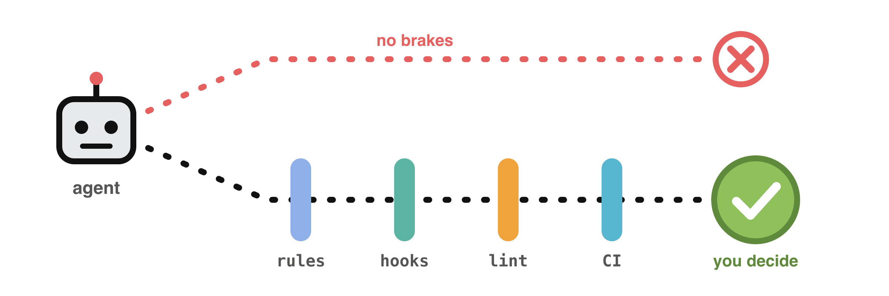

> TL;DR; Agents can write a full feature before you finish your coffee. Your job moved: wear five hats, put your guardrails in the repo instead of the tool, and remember that AI generates ideas, but you are responsible for the final quality. 🎉

### Introduction

Two years ago, on a stage just like this one, my talk started with a simple question: _A.I… A-what?_ The message back then was "it's your responsibility now. Train the machine." Treat it like a baby: guide it, correct it, be patient with it.

That responsibility didn't go away. **It moved.**

The web used to be about mobile, desktop and tablet. Now there's a new platform in that list, and it's not just something inside our apps anymore: it's building our apps. Today, the machine writes a full feature before I finish my coffee. So what is my job now? What is yours?

This post is a summary of my talk _Frontend in the AI Era — Scaling Apps From Prompt to Prod_. I'm not going to transcribe 86 slides; instead, I'll share the few ideas I'd like you to take back to work on Monday.

### Velocity with no brakes

Let's be fair first: vibe coding works. Agents write features, tests and docs in minutes, and autonomous loops keep running while you sleep. Delivery has never been this fast.

But the bill comes later, though:

- Technical debt at agent scale
- A bigger security surface
- Structural decisions made on your behalf — decisions you never actually made

The risk is not obviously bad code. It's **plausible code that nobody understands**.

Addy Osmani describes this as a spectrum of trust. Same tools, three very different relationships: _cognitive offloading_ (you delegate and still own the result), _deferral_ (the output becomes your input and stops being a hypothesis) and _cognitive surrender_ (the output becomes yours and you feel no need to check). The further right you go, the less you check.

> "You don't realize you've surrendered until you need to change something and nobody understands the codebase anymore." — Addy Osmani, on comprehension debt

### A real story: 16 routes, every tab broken

Here's one from a real product (anonymized as AcmeApp). Day one: a security refactor at agent scale. 16 API routes moved behind authentication, handlers stopped trusting the `uid` in the request body and switched to `requireAuth`. Around 30 files and 8 docs were updated together. Unit tests, contract tests and types: all green ✅.

Then the deploy. Every tab opened before the deploy was still running the old JS bundle — no token, `uid` in the body. Result: 401s in production. No test modelled _old client + new server_, because the agent only tested the world it created.

Day two was the guardrail: a `requireAuthOrLegacy` helper accepting both formats for a window, logging every legacy call per route, with removal becoming a ticket once the logs go quiet. And the lesson was written where the next agent reads it: the API skill, a policy test and agent memory.

> Green CI proves the properties you tested. The agent only tested the world it created.

It reminds me of Brazil once giving protest votes to zoo animals — Cacareco the rhino and Tião the chimpanzee. No model predicted that. Real users do things your tests never imagined.

### Five hats, one engineer

If typing code is no longer the bottleneck, what does an engineer do all day? Boris Cherny described it well: typing code got cheap, and these are the jobs left.

1. **Prototyper** — explores many ideas, fast
2. **Builder** — turns prototypes into product
3. **Sweeper** — deletes, simplifies and refactors (agents add code; someone has to remove it)
4. **Growth** — iterates on fit and retention
5. **Maintainer** — keeps it secure and reliable

These used to be five different people. Today they're five hats the same person switches during the day, because the thing that separated them — typing the code — got automated. It's no surprise that Forward Deployed Engineer postings grew **+729%** between April 2025 and April 2026 (Indeed data via Business Insider): that's exactly someone wearing every hat, inside the customer.

> You own outcomes, not lines of code.

And every hat needs tools to enforce its decisions: specs before code for the Prototyper, rule profiles and strict TypeScript for the Builder, custom lint and PR size limits for the Sweeper, typed feature-flag access for Growth, CI gates and human review for the Maintainer.

### Agent-agnostic guardrails: the 4 pillars

The one message of this section: **rules are product architecture, not tool configuration**. Swap your editor or coding agent tomorrow and the guardrails stay, because they're versioned in the repo.

In AcmeApp, everything is edited in one place — an `.agents/` folder plus `AGENTS.md` — and a dependency-free Node script generates the adapter each agent reads. A check runs first in every PR and fails when an adapter is stale or hand-edited. Different agents read different files; they all obey the same source.

#### 1. Agent rule profiles

`AGENTS.md` is a router, not an encyclopedia: commands, mandatory steps, and "read doc X before touching path Y". Under 200 lines; the detail lives in `docs/`. Support files travel with the code: whoever changes the code updates the doc in the same PR.

#### 2. Context is a budget

Tokens are cost and latency. Rules load by glob only when their files are touched, a generated index serves agents without globs, and a "where to read" table maps each area to its doc. My favourite one-liner: _grep `schema.sql`, never load it whole_. One line of rule saves thousands of tokens per session.

#### 3. Strict TypeScript + custom lint

Don't ask the agent nicely. **Make the compiler say no.** AcmeApp has a custom ESLint plugin with 23 rules, and `no-body-uid` exists precisely because of the 16-routes story — the incident became a rule.

```ts
// ✗ acmeapp/no-body-uid
const { uid } = validatedBody.data;

// ✓
const { uid } = await requireAuth(request);
```

The trick worth stealing: every lint message ships the exact fix, import path and code included. **Lint messages are prompts**, so write them for the agent that will read the output. And a doc rule that fails twice becomes a lint rule.

#### 4. CI and a reviewer that can't approve

The check runs before `npm ci`, a cap on source files per PR keeps changes atomic (an agent can't send an 80-file PR), and lint, Semgrep, tests and `tsc` run in parallel. AI review only comments: a bot's approval doesn't replace human review.

Put together, these layers sit between the agent and production — rules the agent reads, hooks that block actions whatever the prompt said, the compiler, and CI plus a human who owns the merge. Memory closes the loop: every correction from a session becomes a new rule or lint rule.

> None of these four knows which agent wrote the code. That's the point.

### Critical thinking is a habit

Tools enforce rules, but tools don't think. That part is still ours. Before you trust an output, Addy Osmani suggests four questions, every time:

1. Did I write down my hypothesis before asking?
2. Am I asking it to help me think, or to think for me?
3. What would have to be true for this to be wrong? Go test that.
4. Would I bet on this in front of the maintainer?

There's also _intent debt_: a vague prompt means the agent fills in the blanks, and decisions you never made become code. Write your own request brief first. Good prompting is critical thinking.

A few weeks ago I sent this message to my team, and it ended up being the anchor of the whole talk:

> **"AI is responsible for generating ideas. We're responsible for the final quality."**

You can offload execution, and much of the auditing. Never accountability.

### From prompt to prod: the agentic factory

To close the talk, I showed a demo with the same use case from my 2024 talk — a "Summarize this page" feature in a Chrome extension powered by Gemini. Back then I wrote it by hand. This time a factory of agents wrote it and I just decided.

- **Define** — the repo gets rules and docs; I approve the spec and the plan. This is where intent debt gets paid.
- **Build** — a loop runs task by task, one commit per task, with pushes blocked by a hook. The key moment: the agent read a feature flag straight from `process.env`, the commit failed, and the lint message told it exactly how to fix it. I didn't ask nicely. The compiler said no.
- **Prove** — reviewers with different lenses, a security check, and an agent opening the real browser to take one screenshot per acceptance criterion.
- **Ship** — the agent asks. I decide.

The orchestration is just orchestration: the `AGENTS.md` and docs it generated are read by any agent.

### That's all for now

Three takeaways from this talk:

- Wear the five hats: you own outcomes, not lines of code.
- Put your guardrails in the repo, not in the tool.
- AI generates ideas. You're responsible for the final quality.

The future is bright, the future is A.I.… and it still needs you. Just in a different place in the chain.

I hope you enjoyed this reading as much as I enjoyed writing it. Thank you so much for reading until the end and see you soon!

🚀🚀🚀🚀🚀🚀

<hr />

### Cya 👋
