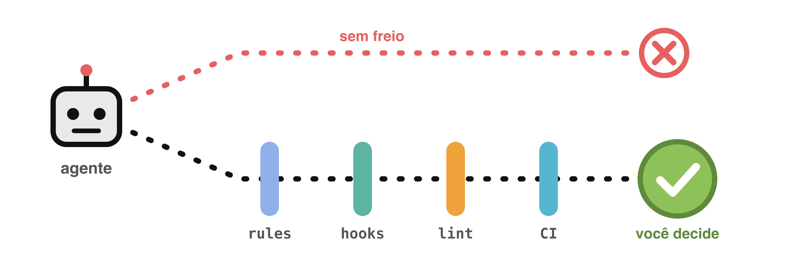

> 🇺🇸 Want to read it in English? [Click here for the English version](/posts/frontend-in-the-ai-era-scaling-apps-from-prompt-to-prod/).

> TL;DR; Agentes conseguem escrever uma feature inteira antes de você terminar o seu café. O seu trabalho mudou de lugar: use os cinco chapéus, coloque os seus guardrails no repositório e não na ferramenta, e lembre que a IA gera ideias, mas a responsabilidade pela qualidade final é sua. 🎉

### Introdução

Dois anos atrás, num palco como esse, a minha palestra começava com uma pergunta simples: _I.A… I.A o quê?_ A mensagem na época era "agora a responsabilidade é sua. Treine a máquina." Trate como um bebê: guie, corrija e tenha paciência.

Essa responsabilidade não foi embora. **Ela mudou de lugar.**

A web costumava ser sobre mobile, desktop e tablet. Agora tem uma nova plataforma nessa lista, e ela não é mais só algo dentro dos nossos apps: ela está construindo os nossos apps. Hoje, a máquina escreve uma feature inteira antes de eu terminar o meu café. Então, qual é o meu trabalho agora? E o seu?

Este post é um resumo da minha palestra _Frontend in the AI Era — Scaling Apps From Prompt to Prod_. Não vou transcrever 86 slides; em vez disso, quero compartilhar as poucas ideias que eu gostaria que vocês levassem para o trabalho na segunda-feira.

### Velocidade sem freio

Vamos ser justos primeiro: _vibe coding_ funciona. Agentes escrevem features, testes e documentação em minutos, e loops autônomos continuam rodando enquanto você dorme. Nunca entregamos tão rápido.

Mas a conta chega depois:

- Dívida técnica na escala dos agentes
- Uma superfície de segurança maior
- Decisões estruturais tomadas no seu lugar — decisões que você nunca tomou de fato

O risco não é código obviamente ruim. É **código plausível que ninguém entende**.

O Addy Osmani descreve isso como um espectro de confiança. As mesmas ferramentas, três relações bem diferentes: _cognitive offloading_ (você delega e continua dono do resultado), _deferral_ (a saída vira a sua entrada e deixa de ser uma hipótese) e _cognitive surrender_ (a saída vira sua e você não sente mais necessidade de checar). Quanto mais para a direita, menos você verifica.

> "Você não percebe que se rendeu até precisar mudar alguma coisa e ninguém mais entender a base de código." — Addy Osmani, sobre _comprehension debt_

### Uma história real: 16 rotas, todas as abas quebradas

Essa veio de um produto real (anonimizado como AcmeApp). Primeiro dia: um refactor de segurança na escala dos agentes. 16 rotas de API foram para trás de autenticação, os handlers pararam de confiar no `uid` do corpo da requisição e passaram a usar `requireAuth`. Cerca de 30 arquivos e 8 documentos atualizados juntos. Testes unitários, testes de contrato e tipos: tudo verde ✅.

Aí veio o deploy. Toda aba aberta antes do deploy ainda rodava o bundle JS antigo — sem token, com o `uid` no corpo. Resultado: 401 em produção. Nenhum teste modelava _cliente antigo + servidor novo_, porque o agente só testou o mundo que ele mesmo criou.

O segundo dia foi o guardrail: um helper `requireAuthOrLegacy` aceitando os dois formatos por um período, registrando cada chamada legada por rota, e a remoção virando um ticket quando os logs silenciarem. E a lição foi escrita onde o próximo agente lê: na skill de API, num teste de política e na memória do agente.

> CI verde prova as propriedades que você testou. O agente só testou o mundo que ele criou.

Isso me lembra o Brasil votando em animais de zoológico como protesto — o rinoceronte Cacareco e o chimpanzé Tião. Nenhum modelo previu isso. Usuários reais fazem coisas que os seus testes nunca imaginaram.

### Cinco chapéus, um engenheiro

Se digitar código não é mais o gargalo, o que um engenheiro faz o dia todo? O Boris Cherny descreveu bem: digitar código ficou barato, e esses são os trabalhos que sobraram.

1. **Prototyper** — explora muitas ideias, rápido
2. **Builder** — transforma protótipos em produto
3. **Sweeper** — apaga, simplifica e refatora (agentes adicionam código; alguém precisa remover)
4. **Growth** — itera em encaixe de produto e retenção
5. **Maintainer** — mantém tudo seguro e confiável

Antes eram cinco pessoas diferentes. Hoje são cinco chapéus que a mesma pessoa troca durante o dia, porque o que separava esses papéis — digitar o código — foi automatizado. Não é surpresa que as vagas de _Forward Deployed Engineer_ cresceram **+729%** entre abril de 2025 e abril de 2026 (dados do Indeed via Business Insider): é exatamente alguém usando todos os chapéus, dentro do cliente.

> Você é dono dos resultados, não das linhas de código.

E todo chapéu precisa de ferramentas para garantir as suas decisões: spec antes do código para o Prototyper, perfis de regras e TypeScript estrito para o Builder, lint customizado e limite de tamanho de PR para o Sweeper, acesso tipado a feature flags para o Growth, gates de CI e revisão humana para o Maintainer.

### Guardrails agnósticos de agente: os 4 pilares

A mensagem principal desta seção: **regras são arquitetura de produto, não configuração de ferramenta**. Troque o seu editor ou o seu agente de código amanhã e os guardrails continuam, porque estão versionados no repositório.

No AcmeApp, tudo é editado num lugar só — uma pasta `.agents/` mais o `AGENTS.md` — e um script Node sem dependências gera o adaptador que cada agente lê. Uma checagem roda primeiro em todo PR e falha quando um adaptador está desatualizado ou foi editado à mão. Agentes diferentes leem arquivos diferentes; todos obedecem à mesma fonte.

#### 1. Perfis de regras para agentes

O `AGENTS.md` é um roteador, não uma enciclopédia: comandos, passos obrigatórios e "leia o doc X antes de mexer no caminho Y". Menos de 200 linhas; o detalhe mora em `docs/`. Arquivos de suporte andam junto com o código: quem muda o código atualiza o doc no mesmo PR.

#### 2. Contexto é orçamento

Tokens são custo e latência. Regras carregam por glob só quando os seus arquivos são tocados, um índice gerado atende agentes sem globs, e uma tabela de "onde ler" mapeia cada área para o seu doc. A minha regra de uma linha favorita: _dê grep no `schema.sql`, nunca carregue ele inteiro_. Uma linha de regra economiza milhares de tokens por sessão.

#### 3. TypeScript estrito + lint customizado

Não peça com educação para o agente. **Faça o compilador dizer não.** O AcmeApp tem um plugin ESLint próprio com 23 regras, e a `no-body-uid` existe justamente por causa da história das 16 rotas — o incidente virou uma regra.

```ts
// ✗ acmeapp/no-body-uid
const { uid } = validatedBody.data;

// ✓
const { uid } = await requireAuth(request);
```

O truque que vale copiar: toda mensagem de lint traz a correção exata, com o caminho do import e o código. **Mensagens de lint são prompts**, então escreva para o agente que vai ler a saída. E uma regra de documentação que falha duas vezes vira uma regra de lint.

#### 4. CI e um revisor que não pode aprovar

A checagem roda antes do `npm ci`, um limite de arquivos de código por PR mantém as mudanças atômicas (um agente não consegue mandar um PR com 80 arquivos), e lint, Semgrep, testes e `tsc` rodam em paralelo. A revisão por IA só comenta: a aprovação de um bot não substitui a revisão humana.

Juntas, essas camadas ficam entre o agente e a produção — regras que o agente lê, hooks que bloqueiam ações independentemente do que o prompt disse, o compilador, e CI mais uma pessoa que é dona do merge. A memória fecha o ciclo: cada correção de uma sessão vira uma nova regra ou regra de lint.

> Nenhum desses quatro sabe qual agente escreveu o código. É exatamente esse o ponto.

### Pensamento crítico é um hábito

Ferramentas garantem regras, mas ferramentas não pensam. Essa parte continua sendo nossa. Antes de confiar numa saída, o Addy Osmani sugere quatro perguntas, sempre:

1. Eu escrevi a minha hipótese antes de perguntar?
2. Estou pedindo para ele me ajudar a pensar, ou para pensar por mim?
3. O que precisaria ser verdade para isso estar errado? Vá testar isso.
4. Eu apostaria nisso na frente de quem mantém o projeto?

Também existe a _intent debt_: um prompt vago faz o agente preencher as lacunas, e decisões que você nunca tomou viram código. Escreva o seu próprio briefing antes. Um bom prompt é pensamento crítico.

Algumas semanas atrás eu mandei esta mensagem para o meu time, e ela acabou virando a âncora da palestra inteira:

> **"A IA é responsável por gerar ideias. Nós somos responsáveis pela qualidade final."**

Você pode delegar a execução, e boa parte da auditoria. Nunca a responsabilidade.

### Do prompt à produção: a fábrica de agentes

Para fechar a palestra, mostrei uma demo com o mesmo caso de uso da minha palestra de 2024 — uma feature "Resumir esta página" numa extensão do Chrome usando Gemini. Naquela época eu escrevi tudo à mão. Desta vez, uma fábrica de agentes escreveu e eu só decidi.

- **Definir** — o repositório ganha regras e docs; eu aprovo a spec e o plano. É aqui que a _intent debt_ é paga.
- **Construir** — um loop roda tarefa por tarefa, um commit por tarefa, com push bloqueado por um hook. O momento-chave: o agente leu uma feature flag direto do `process.env`, o commit falhou, e a mensagem de lint disse exatamente como corrigir. Eu não pedi com educação. O compilador disse não.
- **Provar** — revisores com lentes diferentes, uma checagem de segurança e um agente abrindo o navegador de verdade para tirar um screenshot por critério de aceite.
- **Entregar** — o agente pergunta. Eu decido.

A orquestração é só orquestração: o `AGENTS.md` e os docs gerados são lidos por qualquer agente.

### Isso é tudo por enquanto

Três lições desta palestra:

- Use os cinco chapéus: você é dono dos resultados, não das linhas de código.
- Coloque os seus guardrails no repositório, não na ferramenta.
- A IA gera ideias. A responsabilidade pela qualidade final é sua.

O futuro é brilhante, o futuro é I.A.… e ele ainda precisa de você. Só que num lugar diferente da cadeia.

Espero que vocês tenham gostado da leitura tanto quanto eu gostei de escrever. Muito obrigado por lerem até o final e até a próxima!

🚀🚀🚀🚀🚀🚀

> 🇺🇸 Want to read it in English? [Click here for the English version](/posts/frontend-in-the-ai-era-scaling-apps-from-prompt-to-prod/).

<hr />

### Até mais 👋
