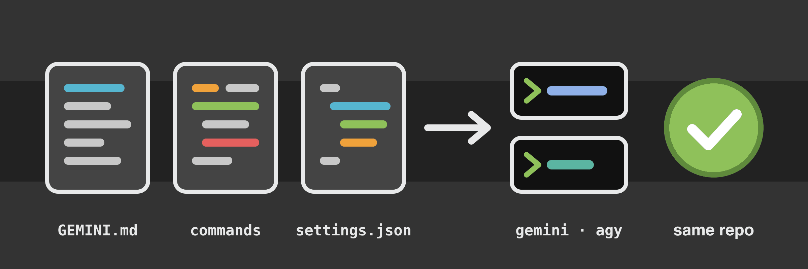

> TL;DR; Put your project context in `GEMINI.md` (or point it at `AGENTS.md`), turn repeated prompts into `.gemini/commands/*.toml`, add MCP servers in `.gemini/settings.json` and run the same setup headless in CI. Since June 2026 most individual users moved to Antigravity CLI, and these files are exactly what makes that move painless. 🎉

### Introduction

Gemini CLI was one of the tools that shaped how we used agents in the terminal. Before we start, an important update: **on June 18, 2026, Gemini CLI stopped serving requests for the free tier and Google AI Pro and Ultra subscribers**, and Google encouraged Gemini CLI users to migrate to the new Antigravity CLI (`agy`), announced with Antigravity 2.0 at Google I/O in May 2026. It stays available with paid Gemini API keys and Gemini Enterprise Agent Platform keys, and for Gemini Code Assist Standard and Enterprise licenses.

So why write about it in November 2026? Because many teams still run it in CI with an API key, and because the files you add to a repo for Gemini CLI are the same files Antigravity CLI reads or imports.

In this article, we'll set up a web project with four pieces: context files, custom commands, extensions and MCP servers, then headless mode. At the end, I'll show how each piece maps to `agy`.

## The Problem with prompt-only workflows

Without repo-level setup, every session starts from zero:

- You re-explain the stack ("Angular, signals, OnPush, Vitest") in every prompt.
- Each teammate writes their own version of the "review my diff" prompt.
- Tools like Chrome DevTools get configured on one laptop only.
- CI can't reproduce what worked locally, because the setup lives in someone's head.

The fix is boring and effective: **put the setup in the repo, next to the code.**

## The Solution: four files in the repo

### 1. `GEMINI.md`: the project context

Gemini CLI concatenates context files and sends them with every prompt. It loads them in layers:

- Global: `~/.gemini/GEMINI.md`, for all your projects.
- Workspace: `GEMINI.md` in your workspace directories and their parents.
- Just-in-time: when a tool touches a file or directory, the CLI scans that location and its ancestors (up to a trusted root) for more `GEMINI.md` files.

A `GEMINI.md` can import other files with `@`, for example `@./docs/conventions.md`. Run `/memory show` to see exactly what the model receives, and `/memory reload` after editing.

If your repo already has an `AGENTS.md`, you don't need a second file. Set `context.fileName` in `.gemini/settings.json`:

```json
{
  "context": {
    "fileName": ["AGENTS.md", "GEMINI.md"]
  }
}
```

That keeps one source of truth for every agent, which is the agent-agnostic idea from [Frontend in the AI Era](/posts/frontend-in-the-ai-era-scaling-apps-from-prompt-to-prod/).

### 2. Custom commands: `.gemini/commands/*.toml`

Repeated prompts become slash commands. Project commands live in `.gemini/commands/` (shared through git) and user commands in `~/.gemini/commands/`. Subfolders become namespaces, so `web/a11y.toml` turns into `/web:a11y`.

```toml
# .gemini/commands/web/a11y.toml
description = "Review staged frontend changes for accessibility issues"
prompt = """
Review this change for accessibility, following @{docs/accessibility.md}.

Staged diff:
!{git diff --staged}

Pay extra attention to: {{args}}
"""
```

As you can see, `prompt` is the only required field. `@{...}` injects a file, `!{...}` runs a shell command (the CLI asks for confirmation first) and `{{args}}` is replaced with whatever you type after the command, like `/web:a11y focus order in the checkout form`. Run `/commands reload` after adding or editing files.

### 3. Extensions and MCP servers

Extensions package commands, context, hooks, subagents, skills and MCP servers, and install from a GitHub URL. As an example, the Chrome DevTools team ships one:

```sh
gemini extensions install --auto-update https://github.com/ChromeDevTools/chrome-devtools-mcp
gemini extensions list
```

You can also add MCP servers directly in `settings.json`, either in `~/.gemini/settings.json` or in the project's `.gemini/settings.json`:

```json
{
  "mcpServers": {
    "chrome-devtools": {
      "command": "npx",
      "args": ["-y", "chrome-devtools-mcp@latest", "--isolated"],
      "timeout": 30000
    }
  }
}
```

Keys like `env`, `cwd`, `httpUrl`, `headers`, `includeTools` and `excludeTools` are available too. Keep `trust` at its default `false`, because `true` bypasses every tool confirmation for that server. `gemini mcp add` writes the same config for you, defaulting to project scope.

> The best prompt is the one nobody on the team has to type again.

### 4. Headless mode for CI

Passing `-p` (or `--prompt`) runs a single prompt non-interactively. Add `--output-format json` to get one object with `response`, `stats` and, on failure, `error`:

```sh
export GEMINI_API_KEY="<from your CI secret store>"
gemini -p "Review the changes in this branch against AGENTS.md and list concrete issues" \
  --output-format json | jq -r '.response' > review.md
```

The exit codes are useful in pipelines: `0` for success, `1` for a general or API error, `42` for invalid input and `53` when the turn limit is exceeded. I keep the default approval mode in CI and avoid `--approval-mode=yolo`, since a pipeline is the worst place for unattended writes.

## Moving the same setup to Antigravity CLI

Here's the good part. Most of this travels with you:

| Gemini CLI                                    | Antigravity CLI (`agy`)                                 |
| --------------------------------------------- | ------------------------------------------------------- |
| `GEMINI.md` / `AGENTS.md` in the workspace    | Same files, same behaviour                               |
| `~/.gemini/GEMINI.md`                         | Same path                                                |
| Extensions and legacy commands                | Plugins and skills, via `agy plugin import gemini`        |
| `.gemini/skills/`                             | `.agents/skills/`                                        |
| `mcpServers` in `settings.json`               | `.agents/mcp_config.json` (remote servers use `serverUrl`) |
| `gemini -p "…"`                               | `agy -p "…"`                                              |

Google was clear that there is no 1:1 feature parity yet, so test your commands after importing them. Still, the effort is small when your context lives in `AGENTS.md` and your prompts live in files instead of chat history.

### Conclusion

Tools change. In 2026 we saw a CLI move from one product to another within a few weeks. What survived was the setup in the repo: context files, reusable prompts and declared tool servers. Invest there first.

## References

- [An important update: Transitioning Gemini CLI to Antigravity CLI](https://developers.googleblog.com/an-important-update-transitioning-gemini-cli-to-antigravity-cli/)
- [Gemini CLI: GEMINI.md context files](https://geminicli.com/docs/cli/gemini-md/)
- [Gemini CLI: Custom commands](https://geminicli.com/docs/cli/custom-commands/)
- [Gemini CLI: Extensions](https://geminicli.com/docs/extensions/)
- [Gemini CLI: MCP servers](https://geminicli.com/docs/tools/mcp-server/)
- [Gemini CLI: Headless mode](https://geminicli.com/docs/cli/headless/)
- [Gemini CLI: CLI reference](https://geminicli.com/docs/cli/cli-reference/)
- [Antigravity docs: Migrating from Gemini CLI](https://antigravity.google/docs/cli/gcli-migration)
- [Antigravity docs: Headless mode](https://antigravity.google/docs/cli/headless)
- [Chrome DevTools MCP](https://github.com/ChromeDevTools/chrome-devtools-mcp)

### That’s all for now

Whatever CLI you use next year, keep the knowledge in the repo and the tool becomes a detail.

I hope you enjoyed this reading as much as I enjoyed writing it. Thank you so much for reading until the end and see you soon!

🚀🚀🚀🚀🚀🚀

<hr />

### Cya 👋
