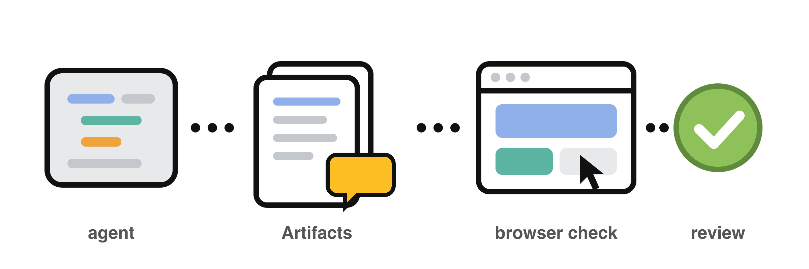

> TL;DR; Google Antigravity is less about the code the agent writes and more about the evidence it hands back: task lists, implementation plans, walkthroughs, screenshots and browser recordings you can comment on. That makes reviews faster, but only if you still read them like a reviewer and not like a spectator. 🎉

### Introduction

Google announced Antigravity on November 20, 2025, together with Gemini 3, as a public preview of an "agent-first" development platform. One year later it is not a single app anymore. There is a standalone desktop App, the Antigravity IDE plus extensions for other editors, a terminal client called `agy` and an SDK.

That growth makes "first impressions" a moving target. So instead of a feature tour, I'd like to focus on the three ideas that stayed the same since day one and that matter for web developers: separate surfaces for doing and for delegating, Artifacts as the unit of review, and a browser the agent uses to check its own work.

**The interesting part is not that an agent writes code. It's that it has to show you why you should trust it.**

### Why a different kind of tool?

In a plain editor with a chat panel, the agent and you share one surface. You prompt, you watch the diff appear, you accept or reject. That works well for small changes, but it gets noisy when the agent runs for several minutes, opens a terminal, starts a dev server and edits ten files.

Antigravity started with two surfaces to deal with that:

- **Editor view**: an AI-powered IDE with tab completions, inline commands and an agent in the side panel. This is the synchronous, hands-on mode.
- **Manager surface** (later known as the _Agent Manager_): a place to spawn, orchestrate and observe several agents working in parallel, each in its own workspace.

With Antigravity 2.0, announced at Google I/O in May 2026, that split became even clearer. The desktop App is the agent-first home, with no editor inside it, and Google said it will remove the Agent Manager from the IDE in an upcoming release. The IDE keeps the hands-on work.

| You want to…                                   | Use                                 |
| ---------------------------------------------- | ----------------------------------- |
| Write and refactor code with suggestions        | Antigravity IDE or an editor extension |
| Delegate a task and review the result later     | The App (agent manager)             |
| Run the same agent from a terminal or script    | Antigravity CLI (`agy`)             |

Keep in mind: two surfaces is not a UI detail. It is a statement about how you work. When you delegate, you stop watching keystrokes and start reviewing deliverables.

### Artifacts: the unit of review

Antigravity calls those deliverables _Artifacts_. The launch post listed task lists, implementation plans, screenshots and browser recordings, and the docs today also mention walkthroughs, code diffs, architecture diagrams and images.

The two that change my day the most are:

#### 1. Implementation plans

Before touching files, the agent writes a plan with the goal, the proposed changes and the files involved. You can trigger one explicitly with the `/plan` slash command. You comment on it inline, much like commenting on a doc. Your comments are attached to your next message, and the agent only continues when you click **Proceed**.

There is a setting for this, called _Plan Review Policy_: **Always Ask** halts the agent for approval whenever it produces a plan or a code diff, while **Always Proceed** lets it continue. According to the docs, the implementation plan still requires your review before the agent changes files, whatever the policy says.

#### 2. Walkthroughs

When the agent finishes, it writes a walkthrough: a short summary of what changed. For browser tasks, you can ask it to embed screenshots, and with `/plan` it is asked to include screenshots and recordings when available. So you can catch up on a task you didn't watch.

> Artifacts turn "trust me" into "here is what I did, comment on it". That is the whole point.

### Browser checks: the agent looks at its own UI

For frontend work, this is the feature that makes Antigravity different from a chat panel. The agent doesn't stop at "the build passes". It opens the page, clicks around, fills forms, takes screenshots, checks responsive layouts and inspects console errors and failed network requests.

How that works depends on the surface:

- **The App (personal accounts)** has a built-in browser in the side panel since late October 2026, with a persistent cookie profile per Antigravity account, separate from your Chrome.
- **The CLI, the IDE and business accounts** use `/browser`, which drives your local Chrome (version 144 or newer) through the Chrome DevTools MCP server. You need Node.js and remote debugging enabled at `chrome://inspect/#remote-debugging`.

The Chrome-based mode also unlocks DevTools performance traces and Lighthouse audits, which I cover in [Chrome DevTools MCP: letting agents measure your Core Web Vitals](/posts/chrome-devtools-mcp-letting-agents-measure-your-core-web-vitals/).

There are sensible guardrails too. Navigating to a site that isn't approved asks for permission (once, for the conversation, or always), and localhost approvals are tied to the port. Identity provider and payment pages are blocked from agent interaction, and payment, sign-in and unapproved cross-origin iframes are masked out of screenshots.

### Models

The model picker is part of the experience, and it changes fast. At launch the headline model was Gemini 3 Pro, with a few third-party models as well. Since November 2026, Gemini 4 Neon is available there for paid Google AI Pro and Ultra plans, and the docs also describe an _Orchestrator_ option that pairs a planner model with a faster executor model. The exact list depends on your plan, so check the models page before you standardise a team on one.

### Where it fits next to a plain editor

I don't see it as a replacement for everything. My rule of thumb:

- **Small, local change** (rename, fix a type, tweak CSS): a plain editor with completions is faster.
- **A feature with UI and a clear acceptance check**: Antigravity shines, because the plan and the browser check are built into the loop. I walk through that flow in [From plan to verified UI](/posts/from-plan-to-verified-ui-an-angular-feature-built-in-antigravity/).
- **Repetitive, scriptable work**: the CLI in headless mode fits better.

It also reads the repo rules you already have. Antigravity discovers `AGENTS.md` and `GEMINI.md` from the workspace up to the repository root and keeps them always active, which is exactly the agent-agnostic setup I argued for in [Frontend in the AI Era](/posts/frontend-in-the-ai-era-scaling-apps-from-prompt-to-prod/).

### The risk: review discipline

Here's the uncomfortable part. Every Artifact is produced by the same agent that wrote the code. A screenshot proves what the agent looked at, not that the feature works for your users. A walkthrough is a summary, and summaries skip things.

Some habits that help:

- Keep the Plan Review Policy on **Always Ask** for anything that touches auth, payments or data.
- Read the plan as if a colleague wrote it. Comment on scope creep before any code exists.
- Treat screenshots as a starting point. Open the page yourself for the states that matter (empty, error, slow network).
- Review the diff, not only the walkthrough. Run your own lint and tests before merging.

> The agent can collect the evidence. Deciding whether it is enough is still your job.

### Lessons Learned

- Two surfaces (doing vs delegating) make long agent runs reviewable.
- Implementation plans are the cheapest place to fix a wrong direction.
- Browser checks catch UI regressions that unit tests never see, but they are not user testing.
- Your repo rules (`AGENTS.md`) travel with you, whatever surface you use.

### References & Further Reading

- [Build with Google Antigravity, our new agentic development platform](https://developers.googleblog.com/build-with-google-antigravity-our-new-agentic-development-platform/)
- [Introducing Google Antigravity 2.0](https://antigravity.google/blog/introducing-google-antigravity-2)
- [Antigravity docs: Artifacts](https://antigravity.google/docs/artifacts)
- [Antigravity docs: Implementation plan](https://antigravity.google/docs/implementation-plan)
- [Antigravity docs: Walkthrough](https://antigravity.google/docs/walkthrough)
- [Antigravity docs: Artifact review](https://antigravity.google/docs/artifact-review)
- [Antigravity docs: Browser use](https://antigravity.google/docs/browser)
- [Antigravity docs: Models](https://antigravity.google/docs/models)
- [Antigravity docs: Rules](https://antigravity.google/docs/rules)

### That’s all for now

Antigravity made me rethink what "done" means for an agent: not the last edit, but the evidence you can review.

I hope you enjoyed this reading as much as I enjoyed writing it. Thank you so much for reading until the end and see you soon!

🚀🚀🚀🚀🚀🚀

### Cya 👋
