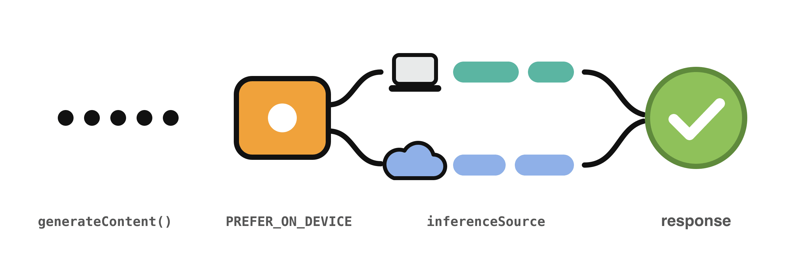

> TL;DR; With the Firebase AI Logic web SDK, `getGenerativeModel(ai, { mode: InferenceMode.PREFER_ON_DEVICE })` runs Gemini Nano in Chrome when the device can, and calls a cloud Gemini model when it can't. Same code, same schema, and `response.inferenceSource` tells you which one answered. 🎉

### Introduction

This is the fourth post of my series _AI on the web in 2026_. In the [previous post](/posts/structured-output-from-the-chrome-prompt-api-with-json-schema/) I ended with "if the device can't run the model, use the cloud". Writing that branching by hand gets old fast: two SDKs, two request formats, two error paths.

Firebase AI Logic has a hybrid mode for the web that does the branching for you. In this article, we'll explore the setup, the four inference modes, structured output on both paths, the limits of the on-device side, and why App Check is not optional.

Keep in mind that hybrid experiences are a **Preview** feature in Firebase AI Logic. That means no SLA or deprecation policy, and the API can change in backwards-incompatible ways. Plan for it.

## The Problem with two code paths

A feature that uses built-in AI in Chrome with a cloud fallback usually ends up like this:

- One branch for `LanguageModel` with its own availability checks and download handling.
- Another branch for a cloud SDK with a different request and response shape.
- Prompts and schemas copied between both, slowly drifting apart.
- No easy way to know, in production, which path users actually hit.

It works. It's also two features pretending to be one.

## The Solution: one model, four modes

You need the Firebase JS SDK v12.5.0 or later, and Chrome on desktop, version 139 or higher, for the on-device side.

```js
import { initializeApp } from 'firebase/app';
import { getAI, getGenerativeModel, GoogleAIBackend, InferenceMode } from 'firebase/ai';

const app = initializeApp(firebaseConfig);
const ai = getAI(app, { backend: new GoogleAIBackend() });

const model = getGenerativeModel(ai, { mode: InferenceMode.PREFER_ON_DEVICE });

// On a user interaction, before the first generateContent() call.
downloadButton.addEventListener('click', () => {
  model.initializeDeviceModel((progress) => renderProgress(progress));
});

const result = await model.generateContent('Summarise this review in one line: ...');
console.log(result.response.inferenceSource); // 'ON_DEVICE' or 'IN_CLOUD'
console.log(result.response.text());
```

As you can see, the request is a normal `generateContent()` call. The mode decides where it runs:

- `PREFER_ON_DEVICE` (the default): on-device when available, cloud otherwise.
- `ONLY_ON_DEVICE`: on-device or it throws.
- `PREFER_IN_CLOUD`: cloud when available, on-device otherwise (handy for offline).
- `ONLY_IN_CLOUD`: cloud or it throws.

The on-device model is not there by default, and the first download can take several minutes. That's why `initializeDeviceModel()` exists: call it from a click that explains what's about to happen, not on page load.

> One API, two engines, and you decide the preference, not the plumbing.

## Tuning each side

The two engines take different knobs, so `getGenerativeModel()` accepts them separately:

```js
const model = getGenerativeModel(ai, {
  mode: InferenceMode.PREFER_ON_DEVICE,
  inCloudParams: {
    model: 'gemini-3.5-flash-lite',
    generationConfig: { maxOutputTokens: 200 },
  },
  onDeviceParams: {
    createOptions: {
      initialPrompts: [{ role: 'system', content: 'You write short, neutral summaries.' }],
    },
  },
});
```

`inCloudParams` follows the regular Gemini model params. `onDeviceParams.createOptions` maps to the Prompt API's `LanguageModel.create()` options, because under the hood the on-device side **is** Chrome's Prompt API. The model name above is the documented default for SDK v13; set it explicitly so an SDK upgrade doesn't change your model silently.

#### Structured output on both paths

This is my favourite part. One `Schema` object, used by both engines:

```js
import { Schema } from 'firebase/ai';

const reviewSchema = Schema.object({
  properties: {
    sentiment: Schema.enumString({ enum: ['positive', 'neutral', 'negative'] }),
    summary: Schema.string(),
  },
});

const model = getGenerativeModel(ai, {
  mode: InferenceMode.PREFER_ON_DEVICE,
  inCloudParams: {
    generationConfig: { responseMimeType: 'application/json', responseSchema: reviewSchema },
  },
  onDeviceParams: {
    promptOptions: { responseConstraint: reviewSchema },
  },
});
```

The cloud side gets it as `responseSchema`, the device side as `responseConstraint`. The contract stays in one place, and you still validate the parsed result like any other untrusted input.

## The limits of the on-device side

On-device supports single-turn text generation, text plus JPEG or PNG images, and structured output. It does **not** support:

- Multi-turn chat.
- Function calling, code execution, URL context, or grounding with Google Search or Maps.
- Audio, video or PDF input, or file URLs.
- Image generation.

The maximum on-device token limit is 9216. With a `PREFER_*` mode, many of those requests fall back to the cloud; with `ONLY_ON_DEVICE`, they throw. A few things aren't supported in hybrid at all: the Live API, server prompt templates and token counting.

One more gotcha: AI monitoring in the Firebase console doesn't show on-device requests. Log `inferenceSource` yourself, otherwise your dashboards will undercount.

## App Check is the price of the cloud path

The cloud fallback calls the Gemini API straight from the browser, so you need App Check to prove the request comes from your app. On the web, the production provider is reCAPTCHA Enterprise. Firebase automatically enforced App Check for Firebase AI Logic on November 2, 2026, so unattested requests can get a `403`.

For replay protection, SDK v12.14.0+ supports limited-use tokens:

```js
const ai = getAI(app, {
  backend: new GoogleAIBackend(),
  useLimitedUseAppCheckTokens: true,
});
```

Each token works once and the SDK fetches a new one per request, which can add latency. Start with "Monitoring only" in the console before enforcing replay protection. And keep App Check debug tokens out of the public repo and out of production builds. Trust me, it's easy to forget one in a `.env` file.

To roll this out gradually, put it behind a flag. I cover that in [feature flagging Gemini features in Angular](/posts/feature-flagging-gemini-features-in-angular-with-ngx-feature-toggle/), and the Angular streaming side is in [streaming Gemini responses into Angular signals](/posts/streaming-gemini-responses-into-angular-signals/).

## References

- [Build hybrid experiences with on-device and cloud-hosted models (Web)](https://firebase.google.com/docs/ai-logic/hybrid-on-device-inference)
- [Configuration options for hybrid experiences in Web apps](https://firebase.google.com/docs/ai-logic/hybrid/web/configuration-options)
- [HybridParams reference](https://firebase.google.com/docs/reference/js/ai.hybridparams)
- [App Check for Firebase AI Logic](https://firebase.google.com/docs/ai-logic/app-check)
- [The Prompt API in Chrome](https://developer.chrome.com/docs/ai/prompt-api)

### That’s all for now

On-device first gives you privacy and zero per-call cost for the users who can run it. The cloud fallback makes sure everyone else still gets the feature.

I hope you enjoyed this reading as much as I enjoyed writing it. Thank you so much for reading until the end and see you soon!

🚀🚀🚀🚀🚀🚀

<hr />

### Cya 👋
