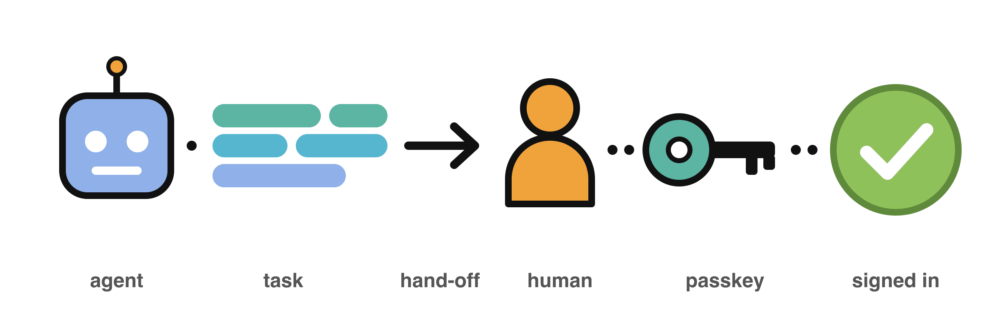

> TL;DR; Agents that browse and act on our behalf make phishable credentials riskier, not safer. Passkeys are bound to the site that created them and need the user to unlock them, so the right design is simple: the agent does the task, the human does the sign-in 🎉

> The goal of this post is to share an opinion, with my reasons, about where sign-in fits now that agents use the web for us.

### Why I keep coming back to this

As a Google Developer Expert in Web Technologies and Identity, I spend a good part of my time on two topics that used to live far apart: identity on the web and the frontend side of AI. In 2026 they collided.

Browsers shipped agents that read pages, fill forms and click buttons. Teams wired coding and browsing agents into their workflows. And every time I see a demo, I ask the same question: **who typed the password?**

I don't have all the answers, and that's not the goal of this post. But I'm convinced about one thing, and I'd like to explain why.

### What changes when an agent is the one reading the page?

#### 1. The attack moves from the user's eyes to the agent's input

Phishing has always worked by tricking a human into typing a secret in the wrong place. With an agent, you don't need to fool the human. You need to fool the agent, and the main threat here has a name: indirect prompt injection. Text in a page, a review or an iframe can try to steer what the agent does next.

The Chrome security team wrote about this in their [post on agentic capabilities](https://blog.google/security/architecting-security-for-agentic/), and they list sign-in as one of the moments where the agent stops and asks the user for confirmation.

#### 2. Passwords and one-time codes are just text

A password is a string. A code from an SMS or an authenticator app is a shorter string. Anything that can read the screen and type into a field can move that string somewhere else: a lookalike domain, a log, a prompt, a tool call.

That was already the weakness with humans. With automation in the middle, there are simply more places for the string to go.

#### 3. Passkeys are not text you can hand over

A passkey is a key pair. The private key stays on the user's devices, and, as [passkeys.dev](https://passkeys.dev/docs/intro/what-are-passkeys/) puts it, "browsers and operating systems enforce that passkeys are only ever used for the appropriate service". A lookalike domain gets nothing, because the browser won't offer a passkey for an origin it wasn't created for.

On top of that, the user unlocks it with a biometric, PIN or pattern. That's user verification, and it's exactly the step an agent can't do for you.

> In the agent era, phishing resistance is not a nice-to-have. It's the boundary between "the agent helped me" and "the agent signed in as me".

### So, should the agent hold my credentials?

No. And I think this is the most important design decision for anyone building agent-friendly web apps.

The agent can find the product, compare prices, prepare the form. When it reaches the sign-in step, it should **hand control back to the human**. Chrome describes this pattern: the agent asks for confirmation before signing in through Google Password Manager, and "the model does not have direct access to stored passwords".

If the agent truly needs to act for the user on another service, that's a job for delegation with scoped tokens, not for a shared password. I go deeper on that in [Agents acting for users: delegation, OAuth scopes, A2A and AP2](/posts/agents-acting-for-users-delegation-oauth-scopes-a2a-and-ap2/).

### What can we do in our apps today?

#### 1. Offer passkeys in the autofill

Conditional UI shows passkeys next to saved passwords when the user focuses the username field. The input needs `autocomplete="username webauthn"`:

```html
<input type="text" name="username" autocomplete="username webauthn" autofocus />
```

```javascript
async function startPasskeyAutofill() {
  if (!window.PublicKeyCredential?.getClientCapabilities) return;

  const capabilities = await PublicKeyCredential.getClientCapabilities();
  if (!capabilities.conditionalGet) return;

  try {
    const response = await fetch('/webauthn/signin-options');
    if (!response.ok) return;
    const options = PublicKeyCredential.parseRequestOptionsFromJSON(await response.json());

    const credential = await navigator.credentials.get({
      publicKey: options,
      mediation: 'conditional',
    });
    // Send credential.toJSON() to the server and verify it there.
  } catch (error) {
    // Aborted or no passkey selected: the password form keeps working.
  }
}
```

#### 2. Create the passkey right after a password sign-in

With conditional create, the browser can add a passkey for the user right after a successful password sign-in, without an extra prompt. Detect it with `conditionalCreate`, then call `navigator.credentials.create()` with `mediation: 'conditional'`. The [Chrome docs](https://developer.chrome.com/docs/identity/webauthn-conditional-create) note that it only works when the password was used recently, so call it immediately after the password login.

```javascript
const capabilities = await PublicKeyCredential.getClientCapabilities?.();
if (capabilities?.conditionalCreate) {
  try {
    const credential = await navigator.credentials.create({
      publicKey: creationOptions,
      mediation: 'conditional',
    });
    // Register credential.toJSON() on the server.
  } catch {
    // Not created this time. Offer it later from the account settings.
  }
}
```

#### 3. Check user verification on the server

[web.dev recommends](https://web.dev/articles/passkey-form-autofill) `userVerification: "preferred"` as a default and checking the User Verified flag on the server. If the action is sensitive, require it.

#### 4. Make the hand-off obvious

Design the sign-in step so a human can pick it up mid-task: a clear page, no hidden iframes, and no flow that expects someone to paste a code they received somewhere else.

### Let's talk about it

I'd love to hear how you're handling this in your apps. Are you letting agents near your sign-in pages? Are you blocking them, or designing a hand-off? There's no single answer yet, and the specs and browser features are still moving.

> **Let the agent do the work. Let the human prove who they are.**

## References

- [Architecting security for agentic capabilities in Chrome](https://blog.google/security/architecting-security-for-agentic/)
- [What are passkeys? (passkeys.dev)](https://passkeys.dev/docs/intro/what-are-passkeys/)
- [Sign in with a passkey through form autofill (web.dev)](https://web.dev/articles/passkey-form-autofill)
- [Simpler WebAuthn feature detection with getClientCapabilities() (web.dev)](https://web.dev/articles/webauthn-client-capabilities)
- [Help users adopt passkeys more seamlessly (Chrome for Developers)](https://developer.chrome.com/docs/identity/webauthn-conditional-create)
- [FIDO Alliance: passkeys](https://fidoalliance.org/passkeys/)

### That’s all for today

Stay tuned because this is not the end, it's just the beginning.

I hope you enjoyed this reading as much as I enjoyed writing it. Thank you so much for reading until the end and see you soon!

🚀🚀🚀🚀🚀🚀

<hr />

### Cya 👋
