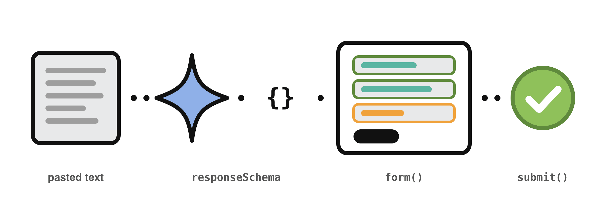

> TL;DR; Let Gemini turn pasted text into JSON with a response schema, write it into the Signal Form's model, and let the form's validators decide what is valid. The model suggests, the validators check, the user confirms. 🎉

### Introduction

"Paste your details here and we'll fill the form for you" is one of the most useful AI features you can add to a web app. It is also one of the easiest to get wrong. A model that writes straight into your submit payload is a model that will, sooner or later, send an email address that is not an email address.

Angular gave us a nice foundation for this in 2026. Signal Forms (`@angular/forms/signals`) arrived as experimental in Angular v21 and became stable in Angular v22. The form is built around a writable signal as the single source of truth, with validation declared as a schema next to it.

In this article, we'll explore how to connect Gemini structured output to that model **without** giving the model the final word.

## The Problem with letting the model fill the form

When AI output goes straight to the backend, a few things go wrong:

- the response can be malformed or contain fields you did not ask for;
- values can look plausible and still be wrong, like a phone number with a missing digit;
- the user never sees what was filled, so they never get a chance to fix it;
- your validation rules end up duplicated, once for humans and again for "the AI path".

> AI output is user input that nobody typed. Validate it the same way.

## The Solution: suggest into the model, validate with the schema

The flow has three steps. Gemini extracts, the Signal Form validates, and the user reviews and submits.

#### 1. Ask Gemini for JSON with a response schema

Firebase AI Logic supports structured output: set `responseMimeType` to `application/json` and pass a `Schema` object as `responseSchema`. This runs from the browser without putting a Gemini API key in your bundle. Protect it with App Check.

```typescript
// contact-extractor.service.ts
import { Injectable } from '@angular/core';
import { initializeApp } from 'firebase/app';
import { getAI, getGenerativeModel, GoogleAIBackend, Schema } from 'firebase/ai';
import { environment } from '../environments/environment';

export interface Contact {
  name: string;
  email: string;
  phone: string;
  company: string;
}

const contactSchema = Schema.object({
  properties: {
    name: Schema.string(),
    email: Schema.string(),
    phone: Schema.string(),
    company: Schema.string(),
  },
  optionalProperties: ['phone', 'company'],
});

@Injectable({ providedIn: 'root' })
export class ContactExtractor {
  private readonly model = getGenerativeModel(
    getAI(initializeApp(environment.firebase), { backend: new GoogleAIBackend() }),
    {
      model: 'gemini-3.8-flash', // check the Firebase AI Logic models page for current names
      generationConfig: { responseMimeType: 'application/json', responseSchema: contactSchema },
    },
  );

  async extract(text: string): Promise<Partial<Contact> | null> {
    try {
      const result = await this.model.generateContent(
        `Extract the contact details from the text below. Omit any field that is not present.\n\n${text}`,
      );
      return toContact(JSON.parse(result.response.text()));
    } catch {
      return null; // network error, blocked response or invalid JSON
    }
  }
}

function toContact(raw: unknown): Partial<Contact> | null {
  if (typeof raw !== 'object' || raw === null) return null;
  const out: Partial<Contact> = {};
  for (const key of ['name', 'email', 'phone', 'company'] as const) {
    const value = (raw as Record<string, unknown>)[key];
    if (typeof value === 'string' && value.trim()) out[key] = value.trim();
  }
  return out;
}
```

As you can see, the schema shapes the response, but I still check it. `toContact` keeps only the keys we know, only as strings. Anything else is dropped before it gets near the form.

#### 2. The Signal Form owns validity

The form is a plain `form()` over a `signal()`, with validators declared in the schema function:

```typescript
// contact-form.component.ts
import { Component, inject, signal } from '@angular/core';
import { form, FormField, required, email, pattern, submit } from '@angular/forms/signals';
import { Contact, ContactExtractor } from './contact-extractor.service';

@Component({
  selector: 'app-contact-form',
  imports: [FormField],
  templateUrl: './contact-form.component.html',
})
export class ContactFormComponent {
  private readonly extractor = inject(ContactExtractor);

  readonly contact = signal<Contact>({ name: '', email: '', phone: '', company: '' });
  readonly contactForm = form(this.contact, (path) => {
    required(path.name, { message: 'Name is required' });
    required(path.email, { message: 'Email is required' });
    email(path.email, { message: 'Enter a valid email address' });
    pattern(path.phone, /^\+?[0-9 ()-]{7,20}$/, { message: 'Enter a valid phone number' });
  });

  readonly suggested = signal<ReadonlySet<keyof Contact>>(new Set());
  readonly extractFailed = signal(false);

  async prefill(text: string) {
    const found = await this.extractor.extract(text);
    this.extractFailed.set(found === null);
    if (!found) return;

    const filled = new Set<keyof Contact>();
    for (const key of Object.keys(found) as (keyof Contact)[]) {
      const field = this.contactForm[key]();
      if (!field.value()) {
        field.value.set(found[key]!);
        field.markAsTouched(); // show validation errors on suggested values right away
        filled.add(key);
      }
    }
    this.suggested.set(filled);
  }

  async save(event: Event) {
    event.preventDefault();
    await submit(this.contactForm, async (f) => {
      await saveContact(f().value()); // your API call
    });
  }
}
```

A few choices here are deliberate:

- **Suggestions never overwrite what the user typed.** Only empty fields get filled.
- **Validators are the same for both paths.** A suggested email goes through `email()` exactly like a typed one. There is no "AI validation" to keep in sync.
- **Suggested fields are marked as touched**, so if Gemini returns `alice@example` the error shows up immediately instead of at submit time.
- **`submit()` is the final gate.** It marks fields as touched, checks validation and runs the action only when nothing failed.

#### 3. The user confirms

The template makes suggestions visible and keeps the user in charge:

```html
<form (submit)="save($event)">
  <label for="email">Email</label>
  <input id="email" type="email" [formField]="contactForm.email" />
  @if (suggested().has('email')) {
    <small>Suggested from your text. Please check it.</small>
  }
  @if (contactForm.email().touched() && contactForm.email().invalid()) {
    @for (error of contactForm.email().errors(); track error) {
      <p role="alert">{{ error.message }}</p>
    }
  }
  <!-- name, phone and company follow the same pattern -->
  <button type="submit" [disabled]="contactForm().submitting()">Save contact</button>
</form>
```

Keep in mind accessibility here: the hint is plain text next to the field, errors use `role="alert"`, and nothing submits on its own. Saving is still an explicit user action.

## What about on-device models?

The same pattern works with the Chrome Prompt API and a JSON Schema, which is covered in [structured output from the Chrome Prompt API](/posts/structured-output-from-the-chrome-prompt-api-with-json-schema/). Only the `extract()` implementation changes. The form, the validators and the review step stay exactly the same, and that is the point.

## Conclusion

Signal Forms make this easy because the model is just a signal and validation is just a schema. Gemini becomes one more source of input, not a new authority. If you want to roll this out carefully, pair it with [feature flags for Gemini features](/posts/feature-flagging-gemini-features-in-angular-with-ngx-feature-toggle/).

## References

- [Angular: Signal Forms overview](https://angular.dev/guide/forms/signals/overview)
- [Angular: Signal Forms validation](https://angular.dev/guide/forms/signals/validation)
- [Angular: Signal Forms models](https://angular.dev/guide/forms/signals/models)
- [Angular: Signal Forms submission](https://angular.dev/guide/forms/signals/form-submission)
- [Firebase AI Logic: Generate structured output](https://firebase.google.com/docs/ai-logic/generate-structured-output)
- [Firebase AI Logic: Supported models](https://firebase.google.com/docs/ai-logic/models)
- [Firebase App Check for Firebase AI Logic](https://firebase.google.com/docs/ai-logic/app-check)

### That’s all for now

Let the model suggest, let the validators decide, and let the user confirm.

I hope you enjoyed this reading as much as I enjoyed writing it. Thank you so much for reading until the end and see you soon!

🚀🚀🚀🚀🚀🚀

<hr />

### Cya 👋
