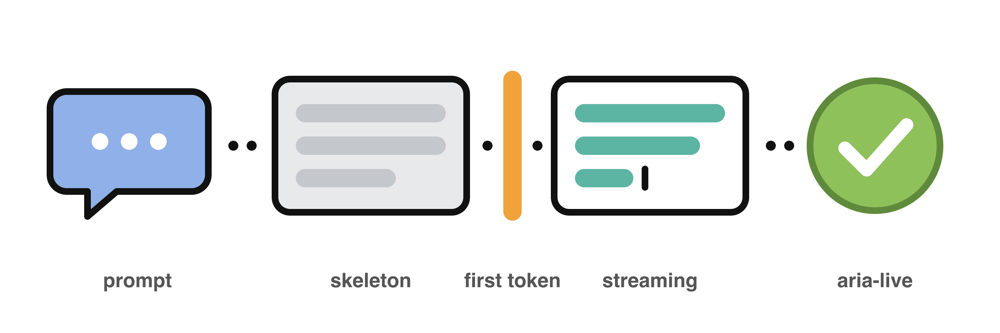

> TL;DR; An LLM response has two waits: the silence before the first token and the stream after it. Show `<ngx-skeleton-loader>` only for the silence, swap it for the streamed text as soon as the first chunk lands, and drive both phases from one signal 🎉

### Introduction

Looking back at 2026, a lot of the UI work around AI features was not about the model at all. It was about **waiting**. A chat answer, a summary, a generated description: they all start with a pause, and then the text arrives piece by piece.

Most apps treat that as a single "loading" state. A spinner spins until the request ends, or the text starts streaming into an empty box with no hint that anything is happening before it. Neither is great.

In this article, we'll explore how to model the two phases of LLM latency with Angular signals, use [ngx-skeleton-loader](https://github.com/willmendesneto/ngx-skeleton-loader) for the first one, and keep screen reader and reduced motion users in mind the whole time. If you want the background on skeletons and perceived performance, I covered it in [NGX-Skeleton-Loader — States, Animations, Performance, and Accessibility](/posts/ngx-skeleton-loader-states-animations-performance-and-accessibility-for-your-angular-app/).

## The Problem with one "loading" flag

A streamed LLM response goes through these phases:

- **idle**: nothing requested yet;
- **waiting**: the request is out, but no token has arrived (time to first token);
- **streaming**: tokens keep arriving and the text grows;
- **done** or **error**.

With a single `isLoading` boolean, you get one of two bad outcomes. Either the skeleton stays on screen while text is already streaming behind it, or there's no feedback during the wait. On top of that, a screen reader can end up announcing every chunk, which is exhausting.

> The skeleton answers "something is coming". The stream answers "here it is". Never show both at once.

## The Solution: one phase signal, two UIs

#### 1. Model the phases with signals

The component keeps a `phase` signal and a `text` signal. The first chunk moves the phase from `waiting` to `streaming`. I'm using `fetch` with a streaming endpoint here, but the same state works for any source that gives you chunks, like the Gemini SDKs or the Chrome built-in AI streaming methods.

```typescript
import { Component, DestroyRef, inject, signal } from '@angular/core';
import { NgxSkeletonLoaderComponent } from 'ngx-skeleton-loader';

type Phase = 'idle' | 'waiting' | 'streaming' | 'done' | 'error';

@Component({
  selector: 'app-ai-answer',
  imports: [NgxSkeletonLoaderComponent],
  templateUrl: './ai-answer.component.html',
})
export class AiAnswerComponent {
  readonly phase = signal<Phase>('idle');
  readonly text = signal('');
  private controller?: AbortController;

  constructor() {
    inject(DestroyRef).onDestroy(() => this.controller?.abort());
  }

  async ask(prompt: string) {
    this.controller?.abort();
    this.controller = new AbortController();
    this.text.set('');
    this.phase.set('waiting');

    try {
      const response = await fetch('/api/answer', {
        method: 'POST',
        body: JSON.stringify({ prompt }),
        headers: { 'Content-Type': 'application/json' },
        signal: this.controller.signal,
      });
      if (!response.ok || !response.body) throw new Error(`HTTP ${response.status}`);

      const reader = response.body.pipeThrough(new TextDecoderStream()).getReader();
      while (true) {
        const { value, done } = await reader.read();
        if (done) break;
        if (this.phase() === 'waiting') this.phase.set('streaming');
        this.text.update((current) => current + value);
      }
      this.phase.set('done');
    } catch (error) {
      if ((error as Error).name !== 'AbortError') this.phase.set('error');
    }
  }
}
```

As you can see, the abort controller covers two unhappy paths: a new question cancels the old stream, and leaving the page doesn't leave a request running.

#### 2. Skeleton for the wait, text for the stream

```html
<section aria-labelledby="answer-title">
  <h2 id="answer-title">Answer</h2>

  @if (phase() === 'waiting') {
    <ngx-skeleton-loader
      count="3"
      animation="pulse"
      ariaLabel="Generating answer"
      loadingText="Waiting for the first words of the answer"
    />
  }

  <div class="answer" aria-live="polite" [attr.aria-busy]="phase() === 'streaming'">
    {{ text() }}
  </div>

  @if (phase() === 'error') {
    <p role="alert">We couldn't generate an answer. Please try again.</p>
  }
</section>
```

`count="3"` draws three lines, which is roughly the shape of a short answer. That matters: the closer the skeleton is to the final layout, the less the page jumps when the text replaces it. You can tune the shape with `appearance`, `width`, `height` or `[theme]`, and use `animation="pulse"` or the default `progress`.

#### 3. What the skeleton already does for accessibility

Since the skeleton is visible only while nothing else is, its accessibility matters. `<ngx-skeleton-loader>` applies the WAI-ARIA attributes once on the host element: `role="progressbar"`, `aria-busy`, `aria-valuemin`, `aria-valuemax`, `aria-label` and `aria-valuetext`. The individual lines are hidden with `aria-hidden="true"`, so screen readers announce **one** progress bar per component, regardless of `count`.

The two inputs you'll want to set are:

- `ariaLabel`: the accessible name of the progress bar (defaults to `loading`);
- `loadingText`: the value used for `aria-valuetext` (defaults to `Loading...`).

Animations, both built-in and custom ones, are disabled automatically when the user enables the reduce motion preference in the operating system or browser. Nothing to configure there.

#### 4. The streamed text: live, but not noisy

The text container is the tricky part. Some details to keep in mind:

- **The live region exists before the text.** The `div` with `aria-live="polite"` is always in the DOM, even when empty. Live regions that appear together with their content are often not announced at all.
- **`aria-busy` while streaming.** MDN describes `aria-busy="true"` as a way to tell assistive technologies that the region is being updated, so they should wait until it turns `false` before announcing it. When the phase moves to `done`, the binding drops to `false` and the final text can be read as a whole. Screen reader support varies, so test this with the readers your users have.
- **Don't move focus to the answer** on every chunk. Let users stay where they are, and offer a clear way to jump to the answer when it's done.

#### 5. Swap, don't stack

The `@if` removes the skeleton in the same change detection pass that renders the first chunk. With signals, that happens without manual subscriptions, also in zoneless apps. There's never a frame where the skeleton and the text compete for the same space.

If you need to delay the skeleton for very fast responses to avoid a flash, add a short timer before switching to `waiting`. Measure your own time to first token before choosing the value.

### What this gives you

- **Honest feedback** for each phase: shape while waiting, text while streaming.
- **One signal** as the source of truth, easy to test and easy to reason about.
- **Accessibility built in**: one progress bar, a polite live region and reduced motion respected.
- **Cancellation** for new prompts and destroyed components.

For the streaming side in more depth, check [Streaming Gemini responses into Angular signals](/posts/streaming-gemini-responses-into-angular-signals/). And if this feature is new in production, put it behind a toggle first, as described in [Feature flagging Gemini features in Angular](/posts/feature-flagging-gemini-features-in-angular-with-ngx-feature-toggle/).

## References

- [ngx-skeleton-loader on GitHub](https://github.com/willmendesneto/ngx-skeleton-loader)
- [ngx-skeleton-loader on npm](https://www.npmjs.com/package/ngx-skeleton-loader)
- [Signals on angular.dev](https://angular.dev/guide/signals)
- [ARIA live regions on MDN](https://developer.mozilla.org/en-US/docs/Web/Accessibility/ARIA/Guides/Live_regions)
- [aria-busy on MDN](https://developer.mozilla.org/en-US/docs/Web/Accessibility/ARIA/Reference/Attributes/aria-busy)
- [prefers-reduced-motion on MDN](https://developer.mozilla.org/en-US/docs/Web/CSS/@media/prefers-reduced-motion)

### That’s all for now

Latency is part of the AI feature, so design it like one.

I hope you enjoyed this reading as much as I enjoyed writing it. Thank you so much for reading until the end and see you soon!

🚀🚀🚀🚀🚀🚀

<hr />

### Cya 👋
