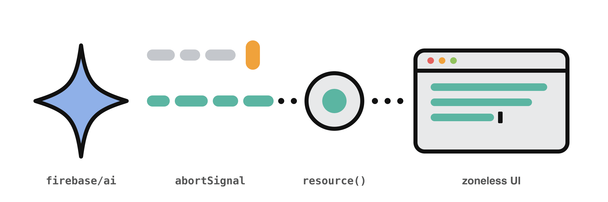

> TL;DR; Wrap `generateContentStream` from Firebase AI Logic in a streaming `resource()`. Every chunk lands in a signal, the template re-renders on its own in a zoneless app, and the resource's `abortSignal` cancels the old request when the prompt changes. 🎉

### Introduction

Waiting several seconds for a full LLM answer and then dropping a wall of text on the screen is the fastest way to make an AI feature feel slow. Streaming fixes most of that perception problem: the first words show up quickly and the rest keep flowing.

In Angular, 2026 made this pattern much simpler. Angular v21 made zoneless change detection the default for new apps, and Angular v22 marked `resource()`, `rxResource()` and `httpResource()` as stable. That gives us a first-class primitive for "async data that changes over time".

In this article, we'll explore how to connect Gemini's streaming API to a signal, keep it zoneless-friendly, and cancel requests that are no longer relevant.

## The Problem with "just await the answer"

The naive version looks like this: call the model, `await` the full response, then set a signal. It works, but:

- the user stares at a spinner for the whole generation time;
- if they change the prompt halfway, the old request keeps running and may overwrite the new answer when it finally resolves;
- teams sometimes "fix" the latency by calling the Gemini API straight from the browser with an API key in the bundle. **Never ship a Gemini API key to the browser.**

That last point matters for the choice of SDK. The `@google/genai` SDK is great on a server you control. In the browser, I prefer the Firebase AI Logic client SDK (`firebase/ai`): it is built to be called from web apps, it does not need the Gemini key in your code, and Firebase recommends enforcing App Check as early as possible to protect the API from unauthorized clients.

> Streaming is a UX feature, cancellation is a correctness feature, and key safety is not optional.

## The Solution: a streaming `resource()`

`resource()` accepts a `stream` option instead of `loader`. A streaming loader returns a signal of `ResourceStreamItem<T>`, which is either `{ value }` or `{ error }`. It also receives the same `params` and `abortSignal` that a normal loader gets.

First, the model, created once in a service:

```typescript
// gemini.service.ts
import { Injectable } from '@angular/core';
import { initializeApp } from 'firebase/app';
import { getAI, getGenerativeModel, GoogleAIBackend } from 'firebase/ai';
import { environment } from '../environments/environment';

@Injectable({ providedIn: 'root' })
export class GeminiService {
  private readonly ai = getAI(initializeApp(environment.firebase), {
    backend: new GoogleAIBackend(),
  });

  // Check the Firebase AI Logic models page for the current stable name,
  // or drive it from Remote Config so you can change it without a deploy.
  readonly model = getGenerativeModel(this.ai, { model: 'gemini-3.8-flash' });
}
```

Then, the component that turns the prompt into a streamed answer:

```typescript
// answer.component.ts
import { Component, inject, resource, signal, ResourceStreamItem } from '@angular/core';
import { GeminiService } from './gemini.service';

@Component({
  selector: 'app-answer',
  template: `
    <form (submit)="ask($event, q.value)">
      <input #q aria-label="Your question" />
      <button>Ask</button>
    </form>

    @if (answer.error()) {
      <p role="alert">Something went wrong. Please try again.</p>
    }
    <p aria-live="polite">{{ answer.value() }}</p>
    @if (answer.isLoading()) {
      <span class="cursor" aria-hidden="true">▍</span>
    }
  `,
})
export class AnswerComponent {
  private readonly gemini = inject(GeminiService);
  readonly prompt = signal<string | undefined>(undefined);

  readonly answer = resource({
    params: () => this.prompt(),
    stream: async ({ params, abortSignal }) => {
      const out = signal<ResourceStreamItem<string>>({ value: '' });
      let text = '';

      try {
        const result = await this.gemini.model.generateContentStream(params, {
          signal: abortSignal,
        });
        (async () => {
          try {
            for await (const chunk of result.stream) {
              text += chunk.text();
              out.set({ value: text });
            }
          } catch (e) {
            if (!abortSignal.aborted) out.set({ error: toError(e) });
          }
        })();
      } catch (e) {
        if (!abortSignal.aborted) out.set({ error: toError(e) });
      }

      return out;
    },
  });

  ask(event: Event, value: string) {
    event.preventDefault();
    this.prompt.set(value.trim() || undefined);
  }
}

function toError(e: unknown): Error {
  return e instanceof Error ? e : new Error(String(e));
}
```

As you can see, there is no `NgZone`, no `ChangeDetectorRef` and no `async` pipe. Let's go through the pieces that make it work.

#### 1. Signals drive rendering, so zoneless just works

Each `out.set(...)` writes to a signal the template reads through `answer.value()`. In a zoneless app, that signal write is what schedules change detection, so nothing depends on Zone.js patching the `for await` loop. With `OnPush` now the default for components in Angular v22, this is exactly the shape Angular expects.

#### 2. `params` returning `undefined` keeps the resource idle

Before the user asks anything, `prompt()` is `undefined`, the stream never runs and the status stays `'idle'`. No accidental empty request on first render.

#### 3. Cancellation comes for free

When `prompt` changes while a stream is still running, the resource aborts the previous operation through `abortSignal`. Passing it to `generateContentStream` as `{ signal: abortSignal }` (a `SingleRequestOptions` field in `firebase/ai`) attempts to cancel the underlying HTTP request. The old answer never overwrites the new one.

Keep in mind one detail from the Firebase reference: aborting does not cancel the request in the backend, so billing still applies. Cancellation protects your UI, not your quota. Debounce or rate-limit the input if users can fire many prompts quickly.

#### 4. Errors are values, not crashes

The stream reports failures as `{ error }`, so `answer.error()` and `answer.status()` reflect them. I check `abortSignal.aborted` first, so an intentional cancellation is not shown as a failure.

## What about `rxResource` or `@google/genai`?

If your app already has an RxJS pipeline (for example, a backend that sends Server-Sent Events), `rxResource()` from `@angular/core/rxjs-interop` takes a `stream` function that returns an `Observable`, and the same ideas apply.

If you need server-only features or want to keep prompts private, put `@google/genai` behind your own endpoint, stream the response with SSE, and point the resource at that endpoint. The browser side stays the same: chunks in, signal out, abort on change.

## Conclusion

Streaming plus signals is one of those combinations that feels obvious once you see it. The resource owns the lifecycle, the signal owns the rendering, and the `abortSignal` owns correctness. If you want to make the waiting part feel even better, the next posts in this series cover [skeleton loaders for streaming UIs](/posts/skeleton-loaders-for-llm-latency-ngx-skeleton-loader-for-streaming-uis/) and [feature flagging Gemini features](/posts/feature-flagging-gemini-features-in-angular-with-ngx-feature-toggle/). For the on-device side of Firebase AI Logic, check [hybrid inference with Firebase AI Logic](/posts/hybrid-inference-with-firebase-ai-logic-on-device-first-cloud-fallback/).

## References

- [Angular: Async reactivity with resources](https://angular.dev/guide/signals/resource)
- [Angular: Zoneless](https://angular.dev/guide/zoneless)
- [Firebase AI Logic: Stream responses](https://firebase.google.com/docs/ai-logic/stream-responses)
- [Firebase AI Logic: Generate text](https://firebase.google.com/docs/ai-logic/generate-text)
- [Firebase AI Logic: Supported models](https://firebase.google.com/docs/ai-logic/models)
- [Firebase JS reference: `SingleRequestOptions`](https://firebase.google.com/docs/reference/js/ai.singlerequestoptions)
- [Firebase JS reference: `GenerativeModel.generateContentStream`](https://firebase.google.com/docs/reference/js/ai.generativemodel)

### That’s all for now

Stream the words, keep the key on the server side of the trust boundary, and let the resource handle cancellation for you.

I hope you enjoyed this reading as much as I enjoyed writing it. Thank you so much for reading until the end and see you soon!

🚀🚀🚀🚀🚀🚀

<hr />

### Cya 👋
