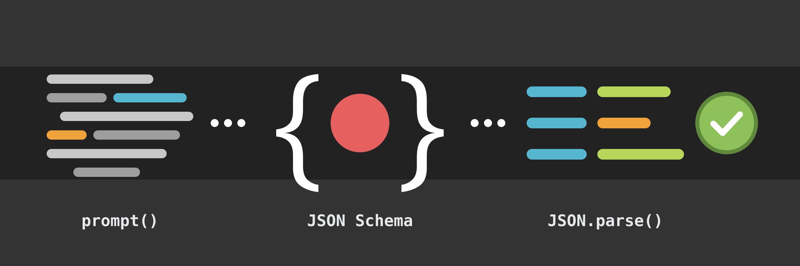

> TL;DR; Pass a JSON Schema as `responseConstraint` to `session.prompt()` and the Prompt API returns JSON you can parse. It is stable on desktop Chrome for the web since Chrome 148. Still validate the result: valid JSON is not the same as correct data. 🎉

### Introduction

This is the third post of my series _AI on the web in 2026_. The [previous one](/posts/built-in-ai-in-chrome-summarizer-translator-language-detector-in-production/) covered the task-based APIs; now it's time for the general one.

The Prompt API gives you a session with the language model that ships with Chrome. That is powerful, and also a bit dangerous for a UI. Models love to be helpful: "Sure! Here is your answer:" followed by Markdown, followed by a friendly closing line. Your component wanted a boolean.

In this article, we'll explore how to constrain the output with JSON Schema, how to validate it, and what the availability looks like at the end of 2026.

## The Problem with free-text answers

Let's say you want to classify a support message into a category and a priority. Asking nicely in the prompt ("answer only with JSON") works most of the time. Most of the time is the problem:

- `JSON.parse()` throws on a trailing sentence or a code fence.
- Field names drift between calls (`priority`, `Priority`, `urgency`).
- Enum values get creative (`"kinda urgent"`).
- Every consumer ends up with its own regex clean-up.

Neither is great for something that renders in production.

## Availability first

The status changed a lot over the last year, so let's be precise. According to the Chrome docs:

- **Chrome Extensions**: the Prompt API is available since Chrome 138.
- **The web**: it ships on desktop since Chrome 148, after an origin trial that started in Chrome 139. Sampling settings for the web (`samplingMode`) are in a separate origin trial.
- Structured output with `responseConstraint` is available since Chrome 137.
- Platforms: Windows, macOS, Linux and Chromebook Plus. Android and iOS are not supported yet.

Extensions that still declare the old `"aiLanguageModelOriginTrial"` permission should remove it; that trial has expired.

## The Solution: `responseConstraint`

```js
const schema = {
  type: 'object',
  properties: {
    category: { type: 'string', enum: ['billing', 'bug', 'account', 'other'] },
    priority: { type: 'string', enum: ['low', 'medium', 'high'] },
    summary: { type: 'string' },
  },
  required: ['category', 'priority', 'summary'],
  additionalProperties: false,
};

async function triage(message) {
  if (!('LanguageModel' in self)) return null;

  const options = {
    expectedInputs: [{ type: 'text', languages: ['en'] }],
    expectedOutputs: [{ type: 'text', languages: ['en'] }],
  };
  if ((await LanguageModel.availability(options)) === 'unavailable') return null;

  const session = await LanguageModel.create({
    ...options,
    initialPrompts: [
      { role: 'system', content: 'You triage customer support messages.' },
    ],
  });

  try {
    const raw = await session.prompt(message, { responseConstraint: schema });
    return JSON.parse(raw);
  } finally {
    session.destroy();
  }
}
```

As you can see, the schema goes in the second argument of `prompt()` (it also works with `promptStreaming()`). The model is constrained to produce JSON that follows it, so `JSON.parse()` is safe and the enums stop drifting.

Keep in mind that `availability()` takes the same options you will use later. That's how Chrome tells you whether the languages and input types you need are supported on this device.

#### Saving context window

By default, the schema is sent to the model as part of the input, which uses context. When your prompt already describes the format, you can skip that:

```js
await session.prompt(message, {
  responseConstraint: schema,
  omitResponseConstraintInput: true,
});
```

If you do that, describe the expected shape in the prompt itself, otherwise the model has less guidance. You can watch the budget with `session.contextUsage` and `session.contextWindow`.

## Validate anyway

> Structured output gives you valid JSON. It doesn't give you true JSON.

The Chrome docs recommend testing your schemas and validating outputs. A constrained model can still pick `"low"` for a message that says the whole checkout is down. So I add two layers:

1. **Schema validation** at the boundary, with the same schema object. With Ajv, that is `const validate = new Ajv().compile(schema)` and then `validate(result)`. If it fails, treat it as "no answer".
2. **Business rules** that the schema can't express. For example, anything mentioning payments never gets `low`.

```js
const result = await triage(text);
if (!result || !validate(result)) {
  return { category: 'other', priority: 'medium', summary: '' }; // safe default
}
```

The schema also becomes a contract you can share with the cloud path. If the device can't run the model, the same schema works as `responseSchema` in Gemini, and that is exactly what [hybrid inference with Firebase AI Logic](/posts/hybrid-inference-with-firebase-ai-logic-on-device-first-cloud-fallback/) does for you.

## A few limits worth knowing

- **Keep schemas small.** The examples in the docs use `type`, `properties`, `items`, `required`, `maxItems`, `additionalProperties` and `pattern`. The docs don't list every supported keyword, so test anything more exotic before relying on it.
- **First use downloads the model.** When `availability()` returns `downloadable` or `downloading`, `create()` starts the download and needs a user gesture.
- **Sessions hold state.** Reuse a session for related prompts, use `session.clone()` to branch, and call `destroy()` when you're done to free resources.
- **Text out only.** The API accepts text, image and audio input, but the output is text. JSON is text, so we are fine.

If you're building forms on top of this, [Signal Forms and Gemini](/posts/signal-forms-and-gemini-ai-assisted-form-filling-that-still-validates/) shows the same "constrain, then validate" idea in Angular.

## References

- [The Prompt API](https://developer.chrome.com/docs/ai/prompt-api)
- [Structured output for the Prompt API](https://developer.chrome.com/docs/ai/structured-output-for-prompt-api)
- [Built-in AI APIs overview](https://developer.chrome.com/docs/ai/built-in-apis)
- [Intent to Ship: Prompt API (blink-dev)](https://groups.google.com/a/chromium.org/g/blink-dev/c/iR6R7-nQeHI)
- [Ajv JSON schema validator](https://ajv.js.org/)

### That’s all for now

Constrain the output, validate the result, and keep a safe default. That's the whole recipe.

I hope you enjoyed this reading as much as I enjoyed writing it. Thank you so much for reading until the end and see you soon!

🚀🚀🚀🚀🚀🚀

<hr />

### Cya 👋
