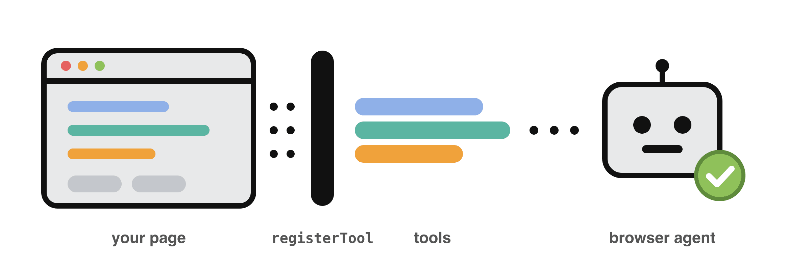

> TL;DR; WebMCP lets your page register tools (`name`, `description`, `inputSchema`, `execute`) with `document.modelContext.registerTool()`, so a browser agent calls your code instead of clicking around your UI. It's a proposal in an origin trial, so ship it as a progressive enhancement and keep anything consequential behind the user. 🎉

_This post is part of my series "AI on the web in 2026". Everything below describes a **proposal**: API names and behaviour may change before anything ships by default._

### Introduction

Browser agents got good at "actuation" this year: reading the DOM or a screenshot, then clicking and typing as if they were the user. It works, until it doesn't. A custom date picker, a multi-step wizard, a button whose label only makes sense to humans, and the agent is guessing.

Neither side is happy. The agent is slow and brittle, and you have no say in how it uses your app.

**WebMCP flips that: the page tells the agent what it can do, and your own code does it.**

In this post, I'll cover what WebMCP is, the current API shape (imperative and declarative), where it runs today, how Angular supports it, and the security rules I'd follow before exposing a single tool.

### What is WebMCP?

WebMCP is a proposal from the W3C Web Machine Learning Community Group. Its spec is a Draft Community Group Report, which means it is **not** on the W3C standards track yet.

The explainer describes pages that use WebMCP as in-page MCP servers: instead of exposing a backend API to an AI platform, the page exposes client-side JavaScript as tools. The difference matters:

- **Same session, same state.** The tool runs in the page, with the user's existing login and UI state. No second backend to replicate auth for.
- **Visible results.** The page updates its UI as the tool runs, so the user sees what the agent did.
- **Complement, not replacement.** The explainer lists replacing backend MCP integrations and fully autonomous, headless workflows as non-goals. It's designed for a human in the loop.

### Where it stands in November 2026

- **Chrome**: an origin trial is live from Chrome 149. For local development, enable `chrome://flags/#enable-webmcp-testing`.
- **Edge**: an origin trial is live in Edge 150.
- **Firefox and Safari**: standards-position discussions are open, with no implementation listed.
- **Tooling**: TypeScript types in the `webmcp-types` package, a polyfill in `@w3c/webmcp-polyfill`, and a WebMCP view in Chrome DevTools to inspect registered tools.

If you read articles from earlier in the year, you may see `navigator.modelContext` or `provideContext()`. The current spec and Chrome docs use `document.modelContext.registerTool()`, which is what I'll use here.

### Step 1 — Register an imperative tool

Here is a plain JavaScript example for a store. One tool only reads, the other one changes state:

```javascript
// Proposal-stage API: feature-detect and treat it as progressive enhancement.
if ('modelContext' in document) {
  const controller = new AbortController();

  await document.modelContext.registerTool(
    {
      name: 'search_products',
      description: 'Searches the catalog and shows matching products on the page.',
      inputSchema: {
        type: 'object',
        properties: {
          query: { type: 'string', description: 'Search keywords.' },
          maxPrice: { type: 'number', description: 'Optional maximum price.' },
        },
        required: ['query'],
      },
      annotations: { readOnlyHint: true },
      async execute({ query, maxPrice }, { signal }) {
        const results = await searchCatalog(query, maxPrice, { signal });
        renderResults(results); // the user sees the same results the agent gets
        return JSON.stringify(results.map(({ id, name, price }) => ({ id, name, price })));
      },
    },
    { signal: controller.signal },
  );

  await document.modelContext.registerTool({
    name: 'add_to_cart',
    description: 'Adds a product to the cart. Does not check out.',
    inputSchema: {
      type: 'object',
      properties: { productId: { type: 'string' }, quantity: { type: 'number' } },
      required: ['productId'],
    },
    annotations: { consequentialHint: true },
    async execute({ productId, quantity = 1 }) {
      await cart.add(productId, quantity); // your existing code path, with its validation
      return `Added ${quantity} x ${productId} to the cart.`;
    },
  });

  // Later, when this view goes away:
  // controller.abort();
}
```

As you can see, there's nothing exotic. The tool reuses the same functions your buttons already call, and the JSON Schema tells the agent exactly what to pass.

The `annotations` are hints for the agent and the browser: `readOnlyHint` for tools without side effects, `consequentialHint` for significant or non-reversible actions (so the agent or browser can ask the user to confirm), and `untrustedContentHint` when the output contains user-generated or external content. The `execute` function also receives a `signal`, so cancelling a tool can cancel its `fetch()` calls too.

### Step 2 — Or annotate a form

For simple cases, the declarative API turns an existing `<form>` into a tool with attributes:

```html
<!-- Proposal-stage attributes -->
<form toolname="request_support" tooldescription="Submits a customer support request." action="/support">
  <label for="email">Email</label>
  <input id="email" name="email" type="email" required />
  <select name="topic" toolparamdescription="Which team should handle the request.">
    <option value="returns">Return my purchase</option>
    <option value="shipping">Where is my package?</option>
  </select>
  <button type="submit">Send</button>
</form>
```

When an agent calls it, the browser focuses the form and fills the fields, and the user still clicks **Send**. Adding `toolautosubmit` lets the agent submit, and the `SubmitEvent` gets an `agentInvoked` flag plus `respondWith()` to return a result. My default: leave `toolautosubmit` off for anything that matters.

### Step 3 — In Angular

Angular has experimental WebMCP support, explicitly marked as subject to change even outside major versions. Tools can be registered per route, which fits how I'd scope them anyway:

```typescript
// routes.ts (experimental Angular API)
import { inject, provideExperimentalWebMcpTools } from '@angular/core';
import { Routes } from '@angular/router';
import { OrdersService } from './orders.service';

export const routes: Routes = [
  {
    path: 'orders',
    loadComponent: () => import('./orders').then((m) => m.Orders),
    providers: [
      provideExperimentalWebMcpTools([
        {
          name: 'getOrderStatus',
          description: 'Returns the status of one of the signed-in user’s orders.',
          inputSchema: {
            type: 'object',
            properties: { orderId: { type: 'string' } },
            required: ['orderId'],
            additionalProperties: false,
          },
          // Runs in an injection context, so `inject()` works here.
          execute: async ({ orderId }) => {
            const status = await inject(OrdersService).statusFor(orderId);
            return { content: [{ type: 'text', text: `Order ${orderId}: ${status}` }] };
          },
        },
      ]),
    ],
  },
];
```

Pair it with `provideRouter(routes, withAutoCleanupInjectors())`, otherwise route tools stay registered after the user navigates away. Angular also infers `execute` parameter types from the schema, but it doesn't validate the arguments at runtime, so check them yourself. If you use Signal Forms, there's an experimental option to expose a form as a tool too, which pairs nicely with [AI-assisted form filling that still validates](/posts/signal-forms-and-gemini-ai-assisted-form-filling-that-still-validates/).

### Security: the rules I'd follow

The Chrome team's security guidance is honest about it: models are probabilistic, and indirect prompt injection is real. So the safety has to live in your code, not in the description text.

#### 1. Expose safe actions first

Start with read-only tools and reversible actions. Checkout, deleting data and changing account settings stay with the user, or behind `consequentialHint` plus your own confirmation UI.

#### 2. Same session, same rules

A tool runs with the user's identity, so it must go through the same authorization and server-side validation as a click. Never add an "agent-only" shortcut that skips checks. For anything that acts beyond the page, see [delegation with OAuth scopes](/posts/agents-acting-for-users-delegation-oauth-scopes-a2a-and-ap2/).

#### 3. Keep tools on your origin

Registration is gated by the `tools` Permissions Policy, which defaults to `self`. Only use `allow="tools"` on iframes or the `exposedTo` option for origins you would share that data with anyway.

#### 4. Label untrusted output

If a tool returns reviews, comments or third-party data, set `untrustedContentHint`, and keep outputs short. Chrome suggests budgets like 500 characters per tool description and 1.5K per tool output.

#### 5. Never return secrets

Return what the agent needs to continue, not tokens, internal IDs or someone else's data.

> A WebMCP tool is a button with a JSON Schema. Give it the same permissions, validation and review you'd give the button 🔐

### What this gives you

- **Reliability**: agents call a function instead of guessing at the DOM.
- **Control**: you decide which actions exist and how they're described.
- **Reuse**: tools wrap the client code you already have.
- **Progressive enhancement**: feature-detect, and the page keeps working for everyone else.

Before registering tools, measure the basics too: [Chrome DevTools MCP](/posts/chrome-devtools-mcp-letting-agents-measure-your-core-web-vitals/) helps check that the page stays fast, and the [talk recap on guardrails](/posts/frontend-in-the-ai-era-scaling-apps-from-prompt-to-prod/) covers the accountability side.

### References & Further Reading

- [WebMCP explainer (webmachinelearning/webmcp)](https://github.com/webmachinelearning/webmcp)
- [WebMCP specification draft](https://webmachinelearning.github.io/webmcp/)
- [WebMCP implementation status](https://github.com/webmachinelearning/webmcp/blob/main/implementation-status.md)
- [WebMCP on Chrome for Developers](https://developer.chrome.com/docs/ai/webmcp)
- [Imperative API](https://developer.chrome.com/docs/ai/webmcp/imperative-api) and [Declarative API](https://developer.chrome.com/docs/ai/webmcp/declarative-api)
- [Build secure WebMCP tools](https://developer.chrome.com/docs/ai/webmcp/secure-tools)
- [WebMCP in Angular](https://angular.dev/ai/webmcp)
- [Model Context Protocol](https://modelcontextprotocol.io/)

### That’s all for now

WebMCP is still a proposal, and I expect the API to keep moving. But the idea is the right one: describe your app's actions on purpose, instead of hoping an agent reads your UI correctly. Stay tuned because this is not the end, it's just the beginning.

I hope you enjoyed this reading as much as I enjoyed writing it. Thank you so much for reading until the end and see you soon!

🚀🚀🚀🚀🚀🚀

<hr />

### Cya 👋
