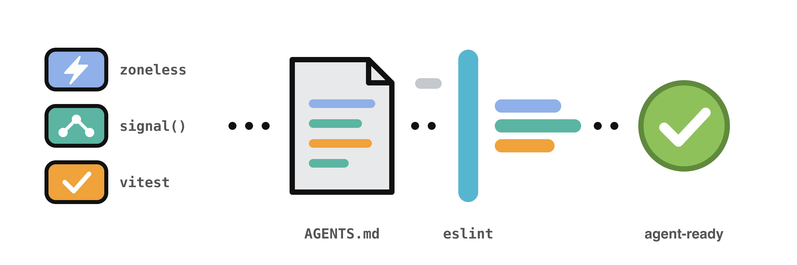

> TL;DR; Agents copy whatever your repo already looks like. Modern Angular defaults (zoneless, signals, standalone, `@if`/`@for`, Vitest) are explicit and local, which is exactly what agents need. Adopt them, write the conventions down in the repo, and let lint gates say "no" before a reviewer has to. 🎉

### Introduction

Looking back at 2026, one pattern kept showing up in Angular codebases where coding agents work well: the agent was rarely the interesting part. **The repo was.**

When the code is explicit, consistent and easy to verify, agents produce code that fits. When the code relies on implicit magic, five generations of patterns and "you just have to know", agents produce code that compiles and quietly makes things worse.

This is an opinion post, so take it as food for thought. I'll argue that the modern Angular defaults are not only nicer for humans, they are a better *interface* for agents. Then I'll show where the conventions should live so every agent, in every tool, follows them.

### Why do modern defaults help agents?

An agent sees a slice of your code, not your whole history. It works best when everything it needs to reason about a component is visible in that slice. Modern Angular is very good at that.

#### 1. Zoneless removes invisible behaviour

Zoneless is the default in Angular v21+. With Zone.js, change detection runs because *something async happened somewhere*. That is impossible to see in a diff. Without it, the UI updates because a signal changed, an event fired or you explicitly asked for it.

For an agent, that turns a hidden runtime rule into a visible code rule: "state that the template reads is a signal". It is easy to follow and easy to review. And since Angular v22 made `OnPush` the default strategy for components, there is one less setting to forget.

#### 2. Signals make data flow local

`signal()`, `computed()`, `linkedSignal()`, `input()`, `output()` and `resource()` keep the "where does this value come from?" question inside the file. An agent that sees `readonly total = computed(() => ...)` knows the dependencies. An agent that sees a `BehaviorSubject` passed through three services has to guess.

#### 3. Standalone and native control flow shrink the surface

No NgModule to update in a different file. No `*ngIf` versus `@if` debate. `@for` requires a `track` expression, so the agent cannot forget it the way it used to forget `trackBy`. Fewer ways to do the same thing means fewer wrong ways for the agent to pick. Long-time readers know how much I care about [tracking in loops](/posts/why-track-loop-is-important-in-your-angular-apps/), so this one makes me happy.

#### 4. Vitest makes "done" cheap to prove

New Angular CLI projects use Vitest by default. Fast feedback matters even more for an agent than for a human, because the agent will happily run the tests ten times in a loop. A quick, deterministic test command turns "I think it works" into "the gate is green". If you need to tune it for CI, I wrote about [thread usage in Vitest](/posts/optimize-thread-usage-in-vitest-for-ci-cd-environments/) a while ago.

> Agents amplify your codebase. Make sure the thing being amplified is the pattern you want.

### What about the existing code?

This is the uncomfortable part. Agents learn from the nearest example. If half the app still uses `*ngFor`, constructor injection and `Default` change detection, the agent will happily write more of it, because it looks "consistent".

So migrations stop being a nice-to-have. The Angular CLI ships schematics for most of these (control flow, signal inputs and queries, `inject()`), and the CLI MCP server includes an `onpush_zoneless_migration` tool that plans the `OnPush` and zoneless move one step at a time. I covered that server in [the previous post of this series](/posts/angular-cli-mcp-server-and-llms-txt-teaching-agents-modern-angular/).

You do not need a big-bang rewrite. You need the *new* code to be unambiguous, and a clear direction for the old code.

### Where should the conventions live?

In the repo. Not in a tool-specific settings panel, not in someone's head, and not in a chat history.

#### 1. A short `AGENTS.md` that routes, not repeats

Keep it small: the commands (`npm run lint`, `ng test`, `ng build`), the mandatory steps before handing off, and links to the docs that matter for each folder. Angular publishes an official [best-practices file](https://angular.dev/assets/context/best-practices.md) that you can vendor and point to, so your own file only needs the rules specific to your team. This is the same idea I described in my talk recap about [agent-agnostic guardrails](/posts/frontend-in-the-ai-era-scaling-apps-from-prompt-to-prod/).

#### 2. Lint rules as the real contract

A rule in Markdown is a suggestion. A rule in ESLint is a gate. `angular-eslint` already covers most modern conventions, for example:

```js
// eslint.config.js (excerpt)
{
  files: ['**/*.ts'],
  rules: {
    '@angular-eslint/prefer-standalone': 'error',
    '@angular-eslint/prefer-signals': 'error',
    '@angular-eslint/prefer-inject': 'error',
    '@angular-eslint/no-uncalled-signals': 'error',
  },
},
{
  files: ['**/*.html'],
  rules: {
    '@angular-eslint/template/prefer-control-flow': 'error',
    '@angular-eslint/template/prefer-ngsrc': 'error',
  },
}
```

As you can see, each line turns a sentence from your conventions doc into something an agent *cannot* ignore. The agent runs the lint, reads the error, fixes it. No reviewer had to type "please use `@if`" for the hundredth time.

#### 3. Gates in the same order, every time

Lint, test, build. The same commands locally, in the agent loop and in CI. When the order is fixed and documented, agents can follow it without improvisation.

### Is this only about agents?

No, and that is the best part. Every point above also helps the new developer who joins next month, the reviewer at the end of a long day, and future you. Agents simply make the cost of ambiguity show up faster, because they repeat it at scale.

I'd love to hear how your team is handling this. Which conventions did you have to write down only after an agent got them wrong?

> **Make the right thing the default, the default thing visible, and the visible thing enforced.**

## References

- [Angular: Zoneless](https://angular.dev/guide/zoneless)
- [Angular: Testing with Vitest](https://angular.dev/guide/testing)
- [Angular: Signals overview](https://angular.dev/guide/signals)
- [Angular best-practices.md](https://angular.dev/assets/context/best-practices.md)
- [Angular CLI MCP Server](https://angular.dev/ai/mcp)
- [angular-eslint rules](https://github.com/angular-eslint/angular-eslint/tree/main/packages/eslint-plugin/docs/rules)
- [angular-eslint template rules](https://github.com/angular-eslint/angular-eslint/tree/main/packages/eslint-plugin-template/docs/rules)

### That’s all for now

Your conventions are part of your codebase now. Treat them like code.

I hope you enjoyed this reading as much as I enjoyed writing it. Thank you so much for reading until the end and see you soon!

🚀🚀🚀🚀🚀🚀

<hr />

### Cya 👋
